<div align="center">

# Space King — Game built on AK Embedded Base Kit


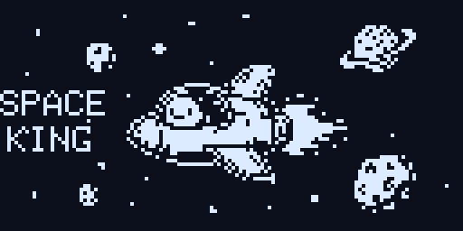

*A 5-round space shooter on a 1.3" 128×64 OLED, built with an event-driven active-object kernel.*

</div>

## Gameplay Demo

Captured from the kit's LCD framebuffer over the serial console (`tools/fb2png.py --record`).

| Round 1 — Enemy fleet | Round 2 — Enemy rain |
|:---:|:---:|
| 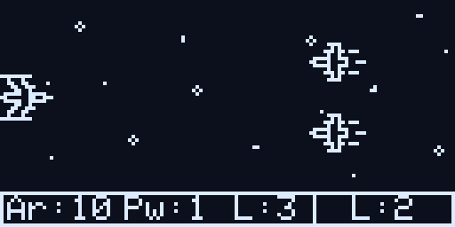 | 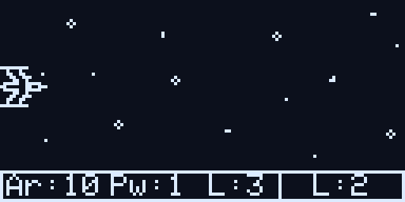 |
| **Round 3 — Zigzag** | **Round 4 — Meteoroid shower** |
|  | 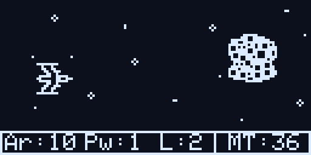 |
| **Round 5 — Boss** | |
| 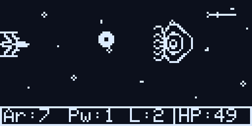 | |

## Documentation

| Document | Content |
|---|---|
| [README.md](README.md) | Overview: hardware, game objects, how to play, sequence overview |
| [Getting started](docs/00-guide-getting-started.md) · [VI](docs/00-huong-dan-bat-dau.md) | Toolchain, build, flash, project layout |
| [Object sequences](docs/01-design-sequence-object.md) · [VI](docs/01-thiet-ke-sequence-object.md) | Spacecraft, arrow, enemy, meteoroid, gift, boss, ... |
| [Runtime sequences](docs/02-design-sequence-runtime.md) · [VI](docs/02-thiet-ke-sequence-runtime.md) | Boot & menu, round start, game tick, round end, buttons |

All sequence diagrams live in [`resources/diagrams/`](resources/diagrams/) as **`.drawio.svg`** files: GitHub shows them as images, and they open directly in [draw.io / diagrams.net](https://app.diagrams.net/) for editing.

## Introduction

**Space King** is a shoot-'em-up game for the [AK Embedded Base Kit](https://github.com/ak-embedded-software/ak-base-kit-stm32l151). The player pilots a spacecraft through five rounds — an enemy fleet, descending enemy waves, a zigzag attack, a meteoroid shower and a final boss — collecting gifts along the way to become the King of space.

The project is a hands-on exercise in event-driven embedded design:

- **System design:** every game object is an *active object* (its own task + signal handler + state), documented with UML sequence diagrams.
- **Process management:** cooperative, run-to-completion tasks scheduled by the AK kernel.
- **Communication:** objects talk only through signals, messages and software timers (`ONE_SHOT` / `PERIODIC`).
- **Control logic:** a screen manager state machine (startup → menu → round → game over) plus per-object state.

## I. Hardware

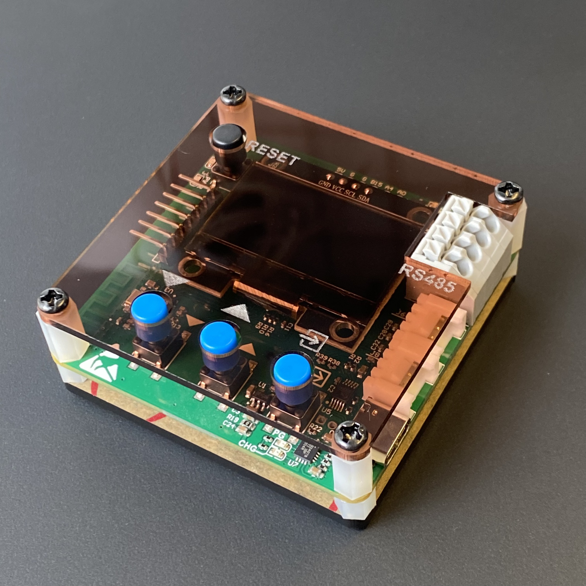

| Component | Detail |
|---|---|
| MCU | STM32L151CBT6 — ARM Cortex-M3, 128 KB Flash, 16 KB RAM |
| Display | 1.3" OLED, 128×64, monochrome |
| Input | 3 push buttons: **MODE**, **UP**, **DOWN** |
| Audio | Buzzer (sound effects, can be muted in Settings) |
| Storage | Internal EEPROM — settings and game progress |
| Host link | USB-UART (CH340) — firmware update with `ak-flash`, debug console |

**Flash layout**

| Address | Partition | Content |
|---|---|---|
| `0x08000000` | Boot | AK bootloader |
| `0x08002000` | BSF | Data shared between bootloader and application |
| `0x08003000` | Application | Space King firmware (`ak-base-kit-stm32l151-application.bin`) |

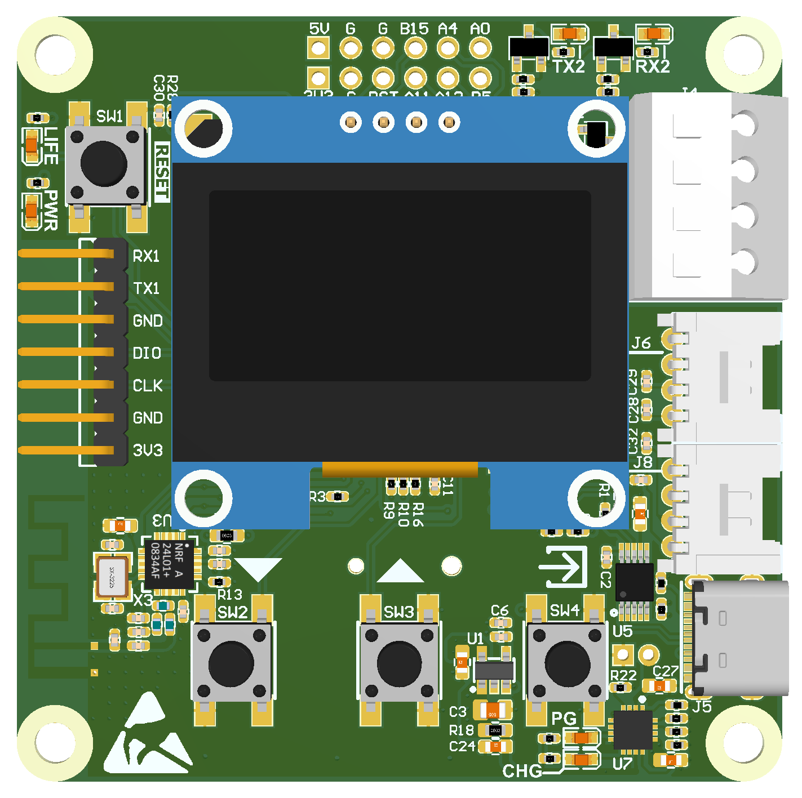

## II. Game Description and Objects

### Screens

| Menu | Menu (scrolled) | Setting |
|:---:|:---:|:---:|
| 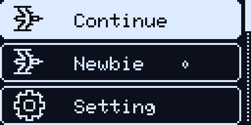 | 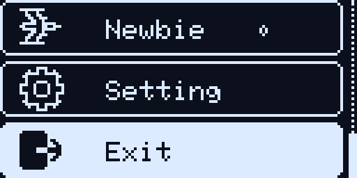 | 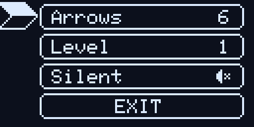 |
| **Victory (after round 5)** | **Game over** | |
| 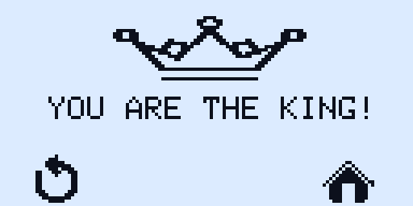 | 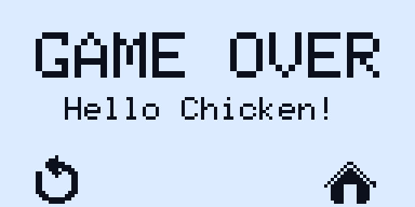 | |

| Screen | Description |
|---|---|
| Startup / Info | AK logo, then the *SPACE KING* info screen (top of this page); loads settings (Silent applied from boot) and saved progress from EEPROM |
| Idle | Bouncing-ball screensaver, after 10 s on Info or 20 s idle on Menu |
| Menu | **Continue** (resume saved round) · **Newbie** (new game from round 1) · **Setting** · **Exit** |
| Setting | Arrows (1–10), Level (1–3), Silent (sound on/off), EXIT (save and back to menu) |
| Change round | "ROUND n — Good Luck!", or "YOU ARE THE KING!" after round 5 (stays until a button: MODE → Info, DOWN → Menu) |
| Game | The playfield + HUD |
| Game over | "GAME OVER — Hello Chicken!" — MODE: back to menu · DOWN: play again from round 1 |

### Rounds

| Round | Name | Gameplay |
|---|---|---|
| 1 | Enemy fleet | 10 enemies fly in and line up in 4 columns; every 2 s, 3 random enemies still alive fire (all of them when fewer than 3 are left). A destroyed enemy flies back in while it still has lives |
| 2 | Enemy rain | Every 2 s, enemies enter from the top in two random columns and fly down; every visible enemy fires every 1.5 s |
| 3 | Zigzag | Like round 2, but alternate columns fly up while the others fly down |
| 4 | Meteoroid shower | Meteoroids fall diagonally; destroy or survive *level × 20* of them. Holding UP/DOWN moves the ship forward/backward |
| 5 | Boss | Boss with *level × 50* HP, energy balls every 4 s and a full-width laser every 10 s. Below 50 % HP it becomes **enraged** and attacks twice as often |

Enemies have *round × 2* HP and *level* lives; meteoroids have *round × 2* HP.

### Objects

<!-- Bitmaps and GIFs rendered from screens_bitmap.cpp by tools/gen_bitmaps.py (frame timing as in the game) -->

| Bitmap | Object | Description |
|:---:|---|---|
| 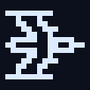 | **Spacecraft** | The player. Moves in 5 px steps, has lives (hearts) and arrow power. When hit it freezes over the shot for 0.3 s, then loses a life, halves its arrow power and respawns after 1 s, blinking while still invincible (3 s in total) |
| 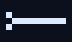 | **Arrow** | Player shot. Damage = arrow power. The number of arrows in flight is limited by the *Arrows* setting |
| 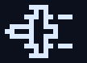 | **Enemy** | Enemy ship (rounds 1–3), 3-frame animation |
|  | **Enemy arrow** | Enemy shot, up to 3 per enemy |
|  | **Meteoroid** | Falls diagonally in round 4; counted when destroyed or when it leaves the screen |
|   | **Boss** | Round 5 boss, wanders randomly on the right side of the screen. Right: defeated frame |
|  | **Energy ball** | Boss skill, flies toward the player |
|  | **Laser** | Boss skill, a horizontal beam that follows the boss for 1 s |
|  | **Gift — Heart** | +1 life |
|  | **Gift — Arrow power** | +1 arrow damage |
| 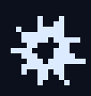 | **Bang** | Explosion, 3 frames then disappears |

## III. How to Play

### Controls

| Button | In game | In menus |
|---|---|---|
| **MODE** | Shoot an arrow (on press) | Select |
| **UP** | Move up on press · hold: move one step per frame (round 4: tap = up, hold = forward) | Previous item · hold in Setting: max values |
| **DOWN** | Move down on press · hold: move one step per frame (round 4: tap = down, hold = backward) | Next item · hold in Setting: min values |

### HUD

`Ar: arrows ready` · `Pw: arrow power` · `L: lives` · right panel: `L: level` (rounds 1–3), `MT: meteoroids left` (round 4), `HP: boss HP` (round 5).

### Rules

- **Goal:** clear all five rounds. A round is cleared when every enemy is out of HP and lives, when the meteoroid counter reaches 0, or when the boss HP reaches 0.
- **Lives:** a new game starts with 3 lives and arrow power 1. Lives and power carry over to the next round and are saved to EEPROM, so **Continue** resumes from the saved round.
- **Gifts:** up to 4 gifts per round are hidden inside random enemies or meteoroids and drop when that object is destroyed. The boss drops a gift every time it loses 20 % of its HP. Fly into a gift to collect it.
- **Arrows:** an arrow returns to the pool when it hits something or has completely left the screen. With no arrow available the buzzer beeps three times.
- **Getting hit:** a shot flying straight into the ship kills it once it is 10 px deep. Moving into a shot kills the ship unless the shot's tail is already 2/3 past the ship's nose. Shots disappear only after leaving the screen.
- **Game over:** when the spacecraft runs out of lives the progress is reset to round 1.

## IV. Game Sequence

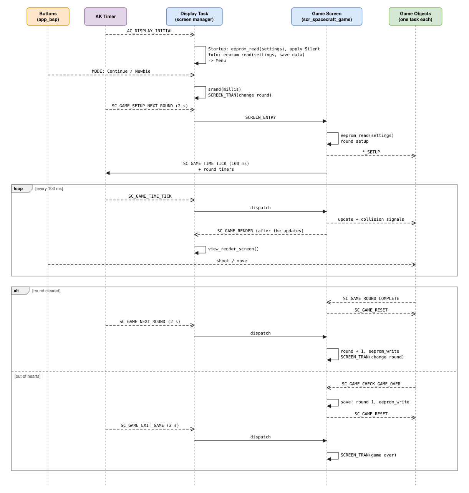

*Figure 1: Overall game sequence — boot, menu, round setup, the 100 ms game tick and the end of a round.*
Solid arrow: direct call · dashed arrow: queued message or timer event · arrow into **AK Timer**: `timer_set()`.

The design is detailed in two documents:

- [Object sequences](docs/01-design-sequence-object.md) — one diagram per game object.
- [Runtime sequences](docs/02-design-sequence-runtime.md) — boot & menu, round start, game tick, round end, button handling.

## V. Build and Flash

```sh
cd ak-base-kit-stm32l151/application
make -j3                          # build
make flash dev=/dev/ttyUSB0       # flash over USB with ak-flash
```

See [Getting started](docs/00-guide-getting-started.md) for toolchain setup, flashing options and the project layout.

## Project Structure

```
Space-King-Game/
├── ak-base-kit-stm32l151/
│   ├── application/            # Game firmware (Makefile, sources/)
│   │   └── sources/app/
│   │       ├── game/spacecraft_game/   # Game objects (one task per object)
│   │       ├── screens/                # Screens + bitmaps
│   │       ├── app.h                   # Signals & timer intervals
│   │       ├── app_bsp.cpp             # Button callbacks
│   │       └── task_list.cpp           # Task table
│   ├── boot/                   # Bootloader
│   └── hardware/               # Schematic, board images
├── ak-flash/                   # Host tool to flash over USB-UART
├── docs/                       # Design & getting-started documents
├── resources/
│   ├── diagrams/               # Sequence diagrams (.drawio.svg)
│   └── images/                 # Bitmaps and illustrations
└── tools/                      # Scripts that generate diagrams and images
```

## Acknowledgements

Built on the [AK Embedded Base Kit](https://github.com/ak-embedded-software/ak-base-kit-stm32l151) and the AK Active Kernel by [AK Embedded Software](https://github.com/ak-embedded-software).

## Author

**Mai Viet Tho** — [github.com/MaiVietTho](https://github.com/MaiVietTho)
