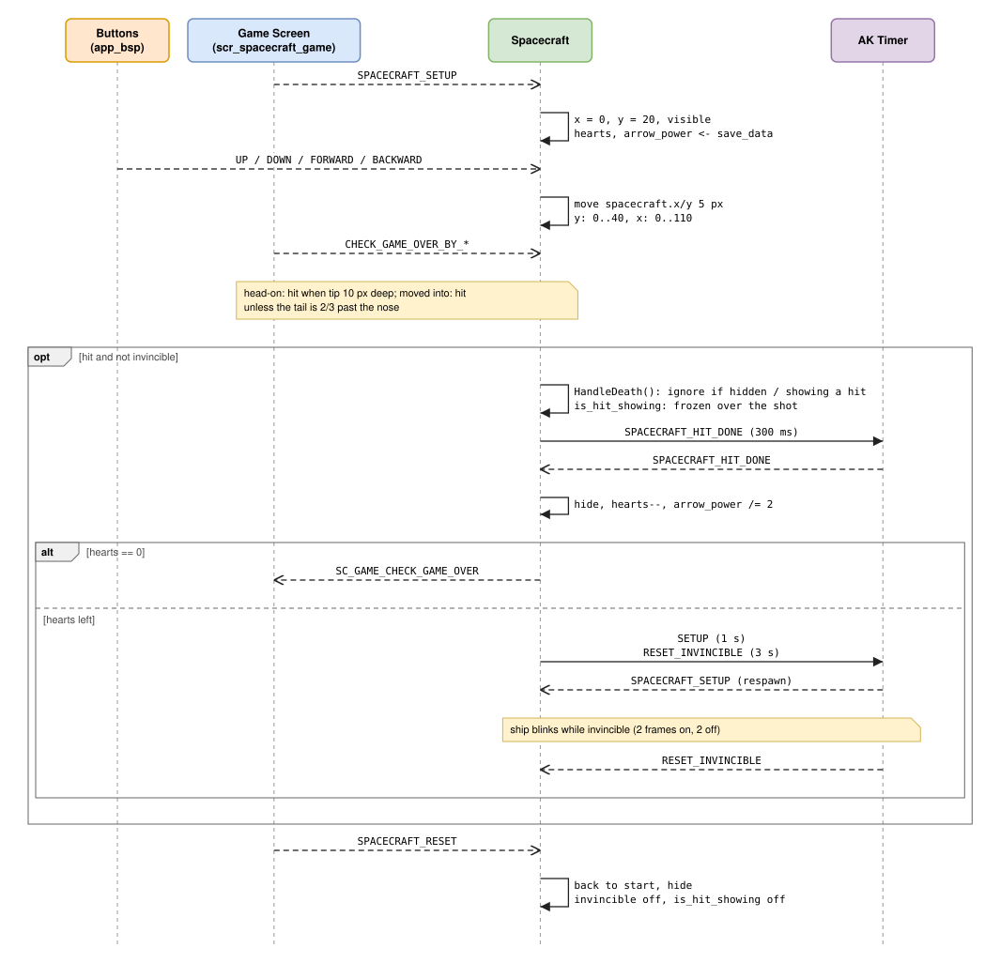
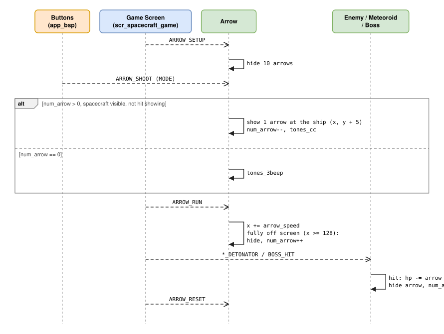
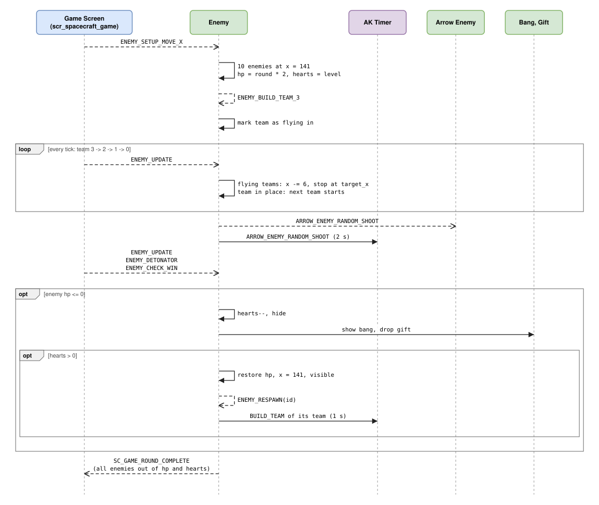
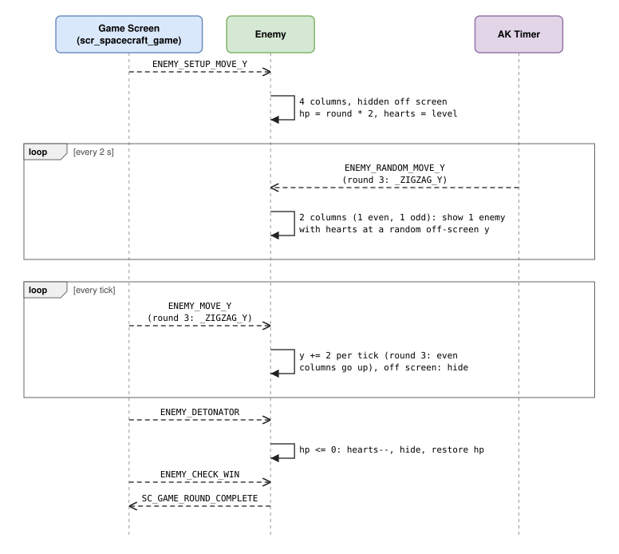
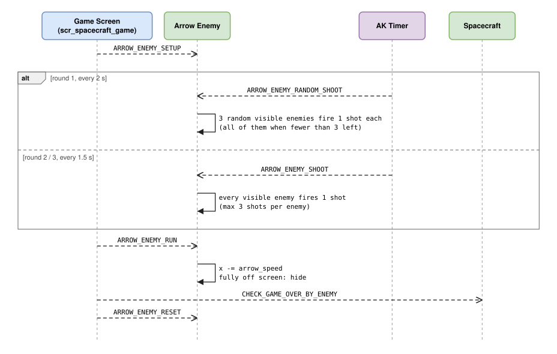
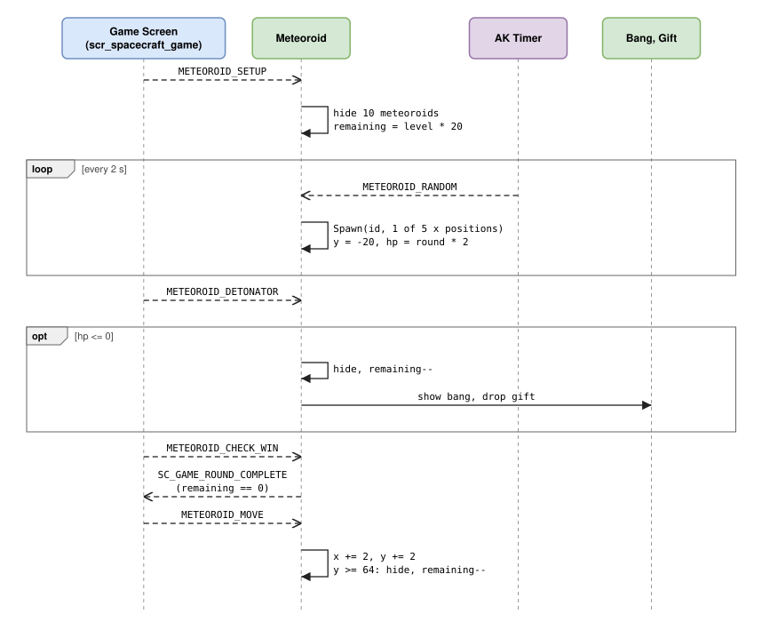
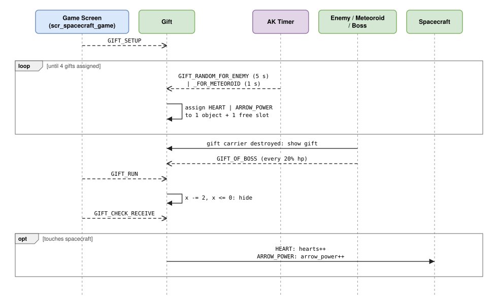
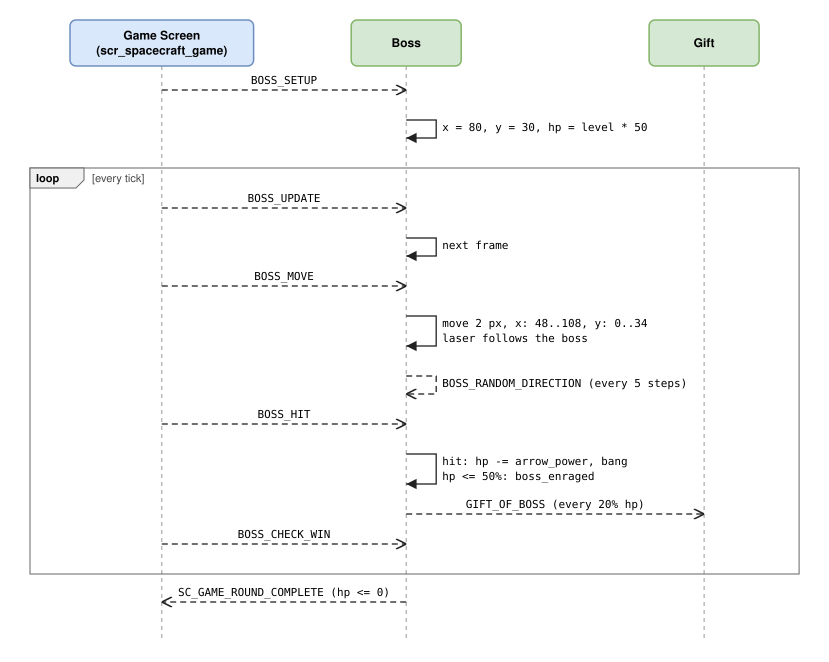
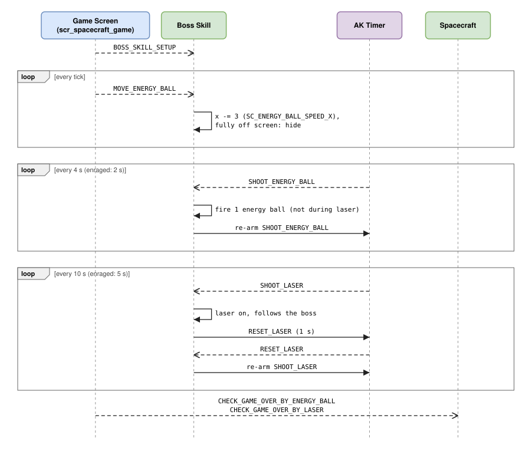
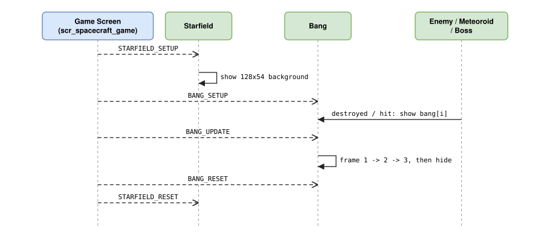

# Game Object Sequences

**English** · [Tiếng Việt](01-thiet-ke-sequence-object.md)

Every object in Space King is an **active object**: its own task, a signal handler (`sc_game_<object>_handle`) and the data that task owns. Objects receive signals from:

- the **Game Screen** (`scr_spacecraft_game`): SETUP / RESET and the update signals of each 100 ms tick,
- the **buttons** (`app_bsp.cpp`): shoot, move the spacecraft,
- the **AK Timer**: the object's own periodic actions (spawn, move, shoot),
- **other objects**: e.g. the Boss sends `SC_GAME_GIFT_OF_BOSS` to Gift.

All game tasks run at `TASK_PRI_LEVEL_4`, so messages are handled in the order they were sent (FIFO) and each handler runs to completion before the next one.

Diagram legend: **solid arrow** is a direct call, **dashed arrow** is a queued message or a timer event, an arrow **into AK Timer** is `timer_set()` with the period in brackets.

## I. Object Summary

| Object | Task ID | Handler | Main responsibility |
|---|---|---|---|
| Spacecraft | `SC_GAME_SPACECRAFT_ID` | `sc_game_spacecraft_handle()` | Position, hearts, arrow power, collisions, death / respawn |
| Arrow | `SC_GAME_ARROW_ID` | `sc_game_arrow_handle()` | Fire and move the player's arrows |
| Enemy | `SC_GAME_ENEMY_ID` | `sc_game_enemy_handle()` | Formation, movement, hits, respawn, win check (rounds 1-3) |
| Arrow Enemy | `SC_GAME_ARROW_ENEMY_ID` | `sc_game_arrow_enemy_handle()` | Enemy shots |
| Meteoroid | `SC_GAME_METEOROID_ID` | `sc_game_meteoroid_handle()` | Spawn, fall, hits, remaining counter (round 4) |
| Gift | `SC_GAME_GIFT_ID` | `sc_game_gift_handle()` | Assign gifts to objects, drop, move, collect |
| Boss | `SC_GAME_BOSS_ID` | `sc_game_boss_handle()` | Movement, hits, enrage, win check (round 5) |
| Boss Skill | `SC_GAME_BOSS_SKILL_ID` | `sc_game_boss_skill_handle()` | Energy ball and laser |
| Bang | `SC_GAME_BANG_ID` | `sc_game_bang_handle()` | Explosion animation |
| Starfield | `SC_GAME_STARFIELD_ID` | `sc_game_starfield_handle()` | Background |

## II. Spacecraft

- **Setup:** places the ship at `x = 0, y = 20`, shows it, and loads `hearts` and `arrow_power` from `save_data` (progress carries over between rounds).
- **Input:** UP / DOWN (and FORWARD / BACKWARD when held in round 4) move `spacecraft.x/y` directly, in 5 px steps, clamped to `y` 0..40 and `x` 0..110.
- **Per tick:** the Game Screen sends the collision check for the current round (`CHECK_GAME_OVER_BY_ENEMY | METEOROID | ENERGY_BALL | LASER`).
- **Enemy shot / energy ball hit:** shots fly left; `pass_x` = nose (`x + 15`) − 2/3 of the ship's width (`SPACECRAFT_SHOT_PASS_X` = 10 px). The ship's `y` at the previous check tells the two cases apart:
  - **Head-on** (ship already in the shot's row): hit when the tip crosses `pass_x` this tick, i.e. the shot is 10 px deep.
  - **Ship moves into the shot's row:** hit while the shot overlaps the ship and its **tail** (`x + 10` for an enemy shot, `x + 8` for an energy ball) has not passed `pass_x`; once the tail is 2/3 past the nose the shot never hits, now or later, and keeps flying until it leaves the screen.
- **Hit:** `scGameSpacecraftHandleDeath()` does not remove the ship right away: it sets `is_hit_showing` and arms `SPACECRAFT_HIT_DONE` (300 ms). Meanwhile the ship stays drawn where it was hit, on top of the shot, so the hit is visible; it cannot move or shoot and further hits are ignored.
- **Death:** `scGameSpacecraftHitDone()` hides the ship, removes one heart and halves the arrow power. With no hearts left it sends `SC_GAME_CHECK_GAME_OVER`; otherwise it arms `SPACECRAFT_SETUP` after 1 s (respawn) and `RESET_INVINCIBLE` after 3 s. Between respawn and `RESET_INVINCIBLE` (about 2 s) the ship blinks: `sc_game_spacecraft_display()` skips drawing it 2 frames out of 4 while `is_invincible` is set. `HandleDeath()` returns early if the ship is hidden or already showing a hit, so one hit cannot count two deaths.
- **Reset:** back to the start position, hidden, invincibility and hit display off.

***Figure 1:** Spacecraft sequence.*

## III. Arrow

- **Setup:** hides the 10 arrow slots.
- **Input:** MODE sends `SC_GAME_ARROW_SHOOT` as soon as it is pressed. If an arrow is available (`settingsetup.num_arrow > 0`), the ship is visible and not showing a hit, one arrow appears on the ship (`x = spacecraft.x`, `y = spacecraft.y + 5`), `num_arrow` decreases and a tone plays. With no arrow left (`num_arrow == 0`) the buzzer beeps three times.
- **Per tick:** `SC_GAME_ARROW_RUN` moves arrows right by `arrow_speed` px; once it has completely left the screen (`x >= 128`) it is hidden and returned to `num_arrow`. Enemies and meteoroids still off screen (`x >= 128`) cannot be hit.
- **Hit:** collision checks are done by Enemy / Meteoroid / Boss; on a hit that object loses `arrow_power` HP, hides the arrow and returns it to `num_arrow`.
- **Reset:** hides all arrows.

***Figure 2:** Arrow sequence.*

## IV. Enemy - round 1

- **Setup:** `SC_GAME_ENEMY_SETUP_MOVE_X` puts 10 enemies at the right edge (`x = 141`) with `hp = round * 2`, `hearts = level`, then starts the formation chain.
- **Formation:** 4 teams fly in one after another, `BUILD_TEAM_3 → 2 → 1 → 0`. `BUILD_TEAM_n` only marks the team as flying; every tick `ENEMY_UPDATE` moves the flying teams 6 px (clamped at `target_x`), so the fly-in stays in step with the frames. The next team makes its first step in the same tick the previous one gets in place (round 1 formation takes about 29 ticks, 2.9 s). When the last team is in place, random shooting starts (`ARROW_ENEMY_RANDOM_SHOOT`, periodic 2 s).
- **Per tick:** `ENEMY_UPDATE` (3-frame animation, 2 ticks per frame), `ENEMY_DETONATOR` (arrow collisions), `ENEMY_CHECK_WIN`.
- **Destroyed:** loses one `hearts`, shows an explosion, drops its gift if any. With `hearts` left, the enemy restores its HP, reappears at `x = 141`, and `SC_GAME_ENEMY_RESPAWN` arms its team's `BUILD_TEAM` after 1 s to fly back into place.
- **Win:** when every enemy is out of both `hp` and `hearts`, sends `SC_GAME_ROUND_COMPLETE`.

***Figure 3:** Enemy sequence in round 1.*

## V. Enemy - round 2 / 3

- **Setup:** `SC_GAME_ENEMY_SETUP_MOVE_Y` arranges the enemies in 4 fixed columns, hidden off screen.
- **Spawn (every 2 s):** picks 2 columns (one even, one odd) and shows one enemy with `hearts` left in each, at a random off-screen `y`.
- **Move (every tick, `ENEMY_MOVE_Y` / `_ZIGZAG_Y`):** `y += 2` per tick (`SC_ENEMY_MOVE_SPEED_Y`). In round 3 (`ZIGZAG`) even columns move up instead. Off-screen enemies are hidden and wait for a later spawn.
- **Destroyed:** loses `hearts`, is hidden and restores its HP; with `hearts` left it can be spawned again.
- **Win:** same as round 1.

***Figure 4:** Enemy sequence in rounds 2 / 3.*

## VI. Arrow Enemy

- **Setup:** hides all shots (max 3 per enemy).
- **Shoot:** round 1 uses `ARROW_ENEMY_RANDOM_SHOOT` (every 2 s, 3 different random enemies picked among the visible ones; all of them when fewer than 3 are left, so the fire rate does not drop as enemies die). Rounds 2 / 3 use `ARROW_ENEMY_SHOOT` (every 1.5 s, every enemy visible on screen).
- **Per tick:** `ARROW_ENEMY_RUN` moves shots left by `arrow_speed` px and hides a shot only once it is completely off screen (`x + 10 <= 0`). Collision with the ship is checked by Spacecraft (`CHECK_GAME_OVER_BY_ENEMY`), see Spacecraft.
- **Reset:** hides all shots.

***Figure 5:** Arrow Enemy sequence.*

## VII. Meteoroid - round 4

- **Setup:** hides the 10 meteoroids, `remaining_meteoroids = level * 20`.
- **Spawn (every 2 s):** `scGameMeteoroidSpawn()` shows a random meteoroid (if hidden) at one of 5 `x` positions, `y = -20`, with full `hp = round * 2`.
- **Per tick:** `DETONATOR` (hit: lose HP; at 0 HP explode, drop gift, decrease `remaining`), `CHECK_WIN` (`remaining == 0` wins), `MOVE` (falls 2 px diagonally; leaving the bottom of the screen also counts and decreases `remaining`). `remaining` never goes below 0.

***Figure 6:** Meteoroid sequence.*

## VIII. Gift

- **Setup:** resets the counter, clears the `has_gift` flags of enemies / meteoroids, clears the 4 gift slots.
- **Assign:** `GIFT_RANDOM_FOR_ENEMY` (every 5 s) picks an enemy with `hearts` left, `GIFT_RANDOM_FOR_METEOROID` (every 1 s) picks a meteoroid, as long as it has no gift yet and a slot is free; the type is a random `HEART` or `ARROW_POWER`. Stops after 4 gifts in the round.
- **Drop:** when a gift carrier is destroyed, its own gift slot appears at its position. The boss drops a gift through `SC_GAME_GIFT_OF_BOSS` each time it loses 20 % of its HP.
- **Per tick:** `GIFT_RUN` moves gifts left by 2 px; `GIFT_CHECK_RECEIVE` checks contact with the ship: `HEART` +1 heart, `ARROW_POWER` +1 arrow power.

***Figure 7:** Gift sequence.*

## IX. Boss - round 5

- **Setup:** `x = 80, y = 30`, `hp = level * 50`, first gift threshold at 80 % HP.
- **Per tick:** `BOSS_UPDATE` (animation), `BOSS_MOVE` (2 px in the current direction within `x` 48..108, `y` 0..34, the laser follows; a new random direction every 5 steps), `BOSS_HIT` (hit: lose HP, explosion; below 50 % HP it becomes **enraged**; each 20 % threshold drops a gift), `BOSS_CHECK_WIN` (`hp <= 0` wins).

***Figure 8:** Boss sequence.*

## X. Boss Skill

- **Energy ball:** `SHOOT_ENERGY_BALL` (one-shot, 4 s, 2 s when enraged, re-armed each time) fires a ball from the boss, except while the laser is on. `MOVE_ENERGY_BALL` (every tick) moves balls left, 3 px per tick (`SC_ENERGY_BALL_SPEED_X`).
- **Laser:** `SHOOT_LASER` (10 s, 5 s when enraged) turns on a horizontal laser that follows the boss and arms `RESET_LASER` after 1 s; `RESET_LASER` turns it off and arms the next shot. The two signals alternate, so they use one-shot timers.
- **Collisions:** checked by Spacecraft (`CHECK_GAME_OVER_BY_ENERGY_BALL`, `_BY_LASER`); energy balls use the same 2/3 rule as enemy shots and are hidden once completely off screen.

***Figure 9:** Boss Skill sequence.*

## XI. Bang and Starfield

- **Bang:** Enemy / Meteoroid / Boss show `bang[i]` where something is destroyed or hit; each tick `BANG_UPDATE` steps frame 1 → 2 → 3 and then hides it.
- **Starfield:** static 128x54 background with only SETUP (show) and RESET (hide).

***Figure 10:** Bang and Starfield sequence.*

## XII. Per-Tick Signal Order

On every `SC_GAME_TIME_TICK` (100 ms), `scGameSpacecraftTimeTick()` sends, in order:

1. `SC_GAME_ARROW_RUN`
2. `SC_GAME_BANG_UPDATE`
3. `SC_GAME_GIFT_CHECK_RECEIVE`
4. `SC_GAME_GIFT_RUN`
5. Depending on the round:
   - **Rounds 1-3:** (round 2: `ENEMY_MOVE_Y`, round 3: `ENEMY_MOVE_ZIGZAG_Y`), `ARROW_ENEMY_RUN`, `ENEMY_UPDATE`, `ENEMY_DETONATOR`, `ENEMY_CHECK_WIN`, `SPACECRAFT_CHECK_GAME_OVER_BY_ENEMY`
   - **Round 4:** `METEOROID_DETONATOR`, `METEOROID_CHECK_WIN`, `METEOROID_MOVE`, `SPACECRAFT_CHECK_GAME_OVER_BY_METEOROID`
   - **Round 5:** `BOSS_SKILL_MOVE_ENERGY_BALL`, `BOSS_UPDATE`, `BOSS_MOVE`, `BOSS_HIT`, `BOSS_CHECK_WIN`, `SPACECRAFT_CHECK_GAME_OVER_BY_ENERGY_BALL`, `SPACECRAFT_CHECK_GAME_OVER_BY_LASER`
6. `SC_GAME_RENDER` → Display: queued after all the updates above, so the frame shows this tick's positions.

## XIII. Code References

Paths are relative to `ak-base-kit-stm32l151/application/sources/app/`.

| Object | Source | Header |
|---|---|---|
| Spacecraft | `game/spacecraft_game/sc_game_spacecraft.cpp` | `sc_game_spacecraft.h` |
| Arrow | `game/spacecraft_game/sc_game_arrow.cpp` | `sc_game_arrow.h` |
| Enemy | `game/spacecraft_game/sc_game_enemy.cpp` | `sc_game_enemy.h` |
| Arrow Enemy | `game/spacecraft_game/sc_game_arrow_enemy.cpp` | `sc_game_arrow_enemy.h` |
| Meteoroid | `game/spacecraft_game/sc_game_meteoroid.cpp` | `sc_game_meteoroid.h` |
| Gift | `game/spacecraft_game/sc_game_gift.cpp` | `sc_game_gift.h` |
| Boss | `game/spacecraft_game/sc_game_boss.cpp` | `sc_game_boss.h` |
| Boss Skill | `game/spacecraft_game/sc_game_boss_skill.cpp` | `sc_game_boss_skill.h` |
| Bang | `game/spacecraft_game/sc_game_bang.cpp` | `sc_game_bang.h` |
| Starfield | `game/spacecraft_game/sc_game_starfield.cpp` | `sc_game_starfield.h` |
| Signals, intervals | `app.h` | |
