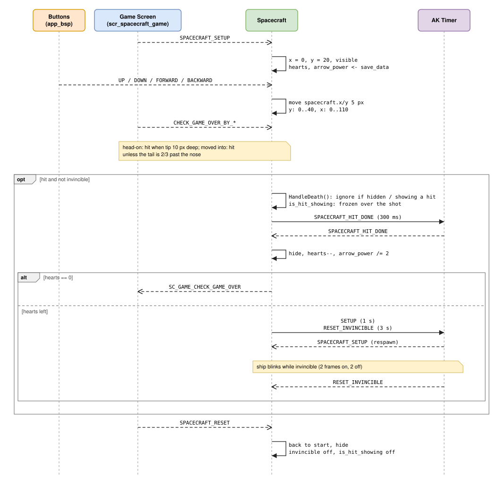
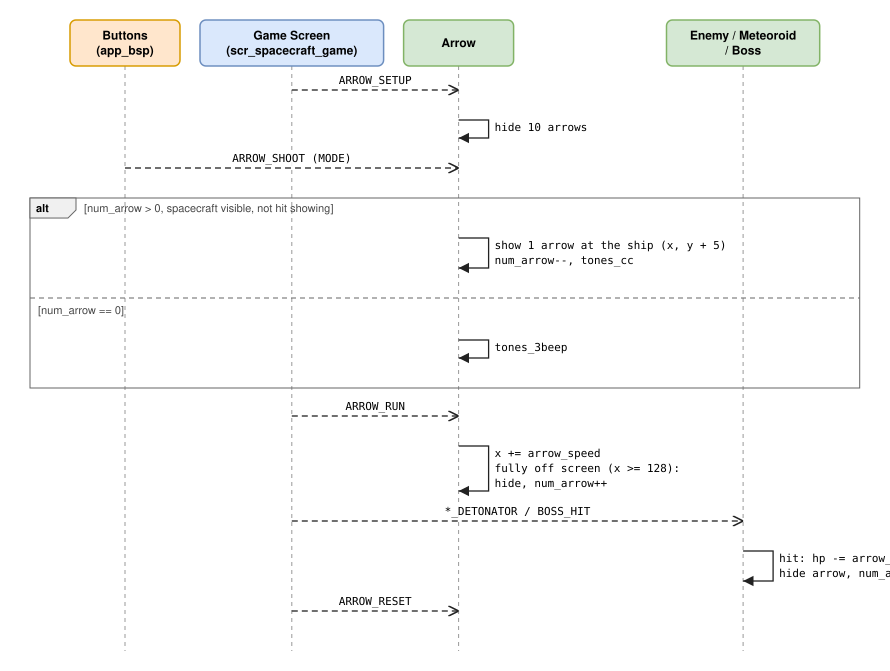
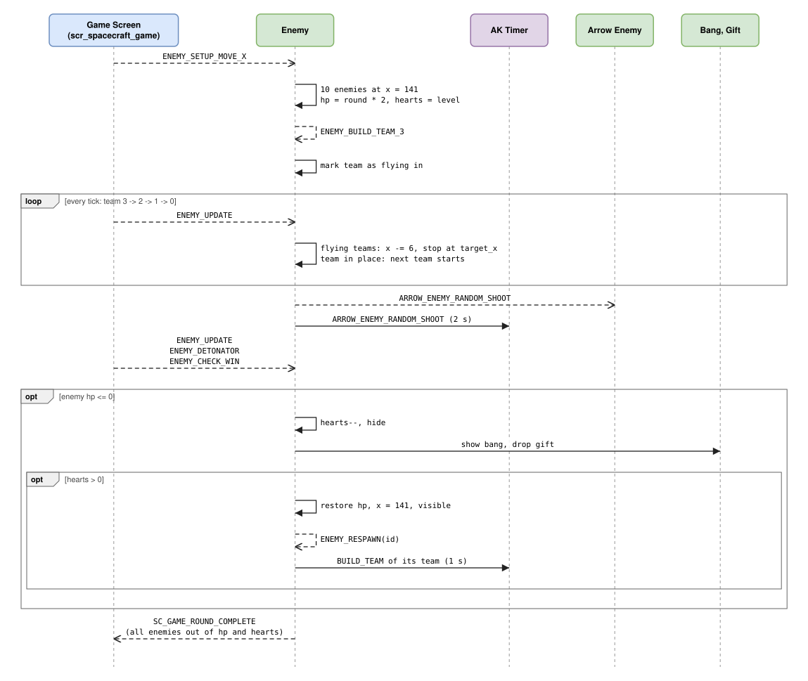
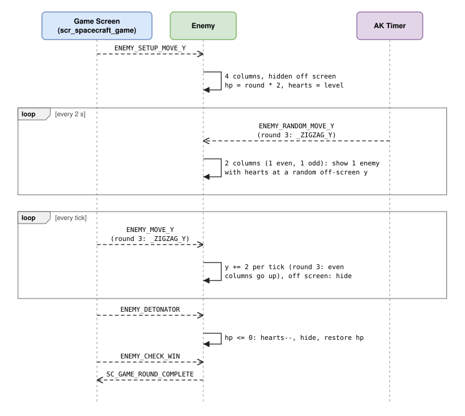
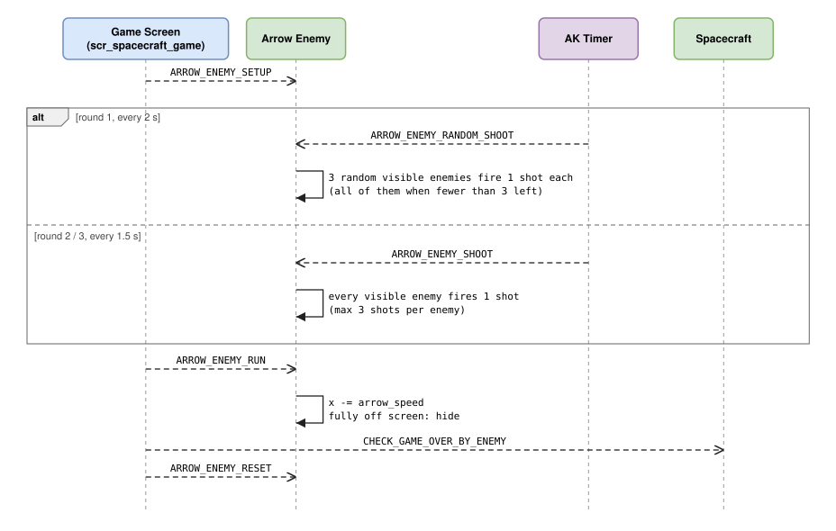
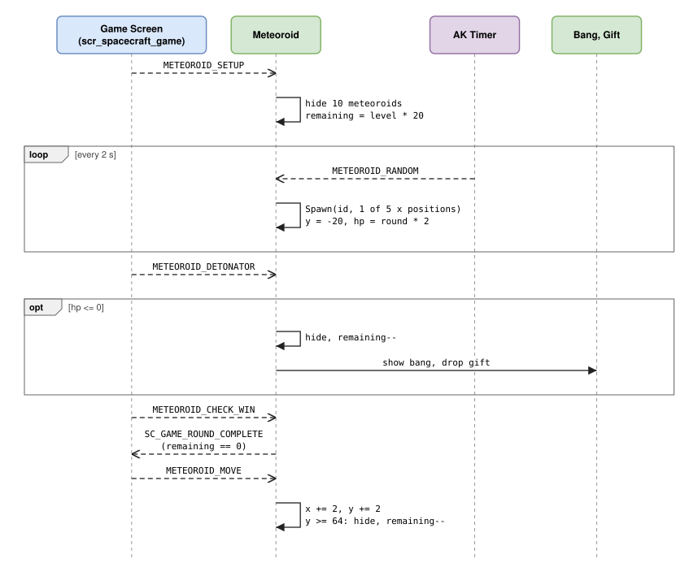
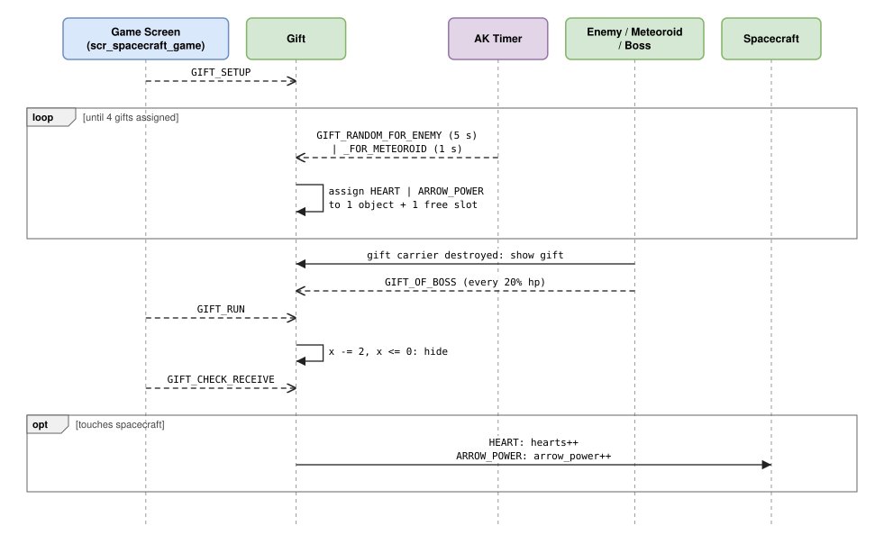
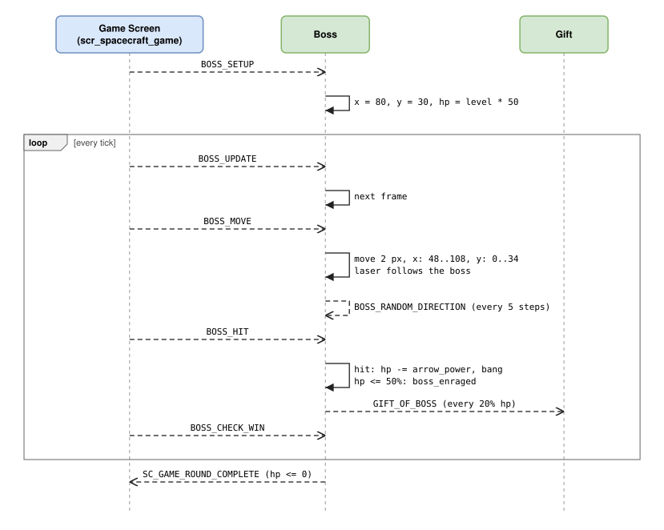
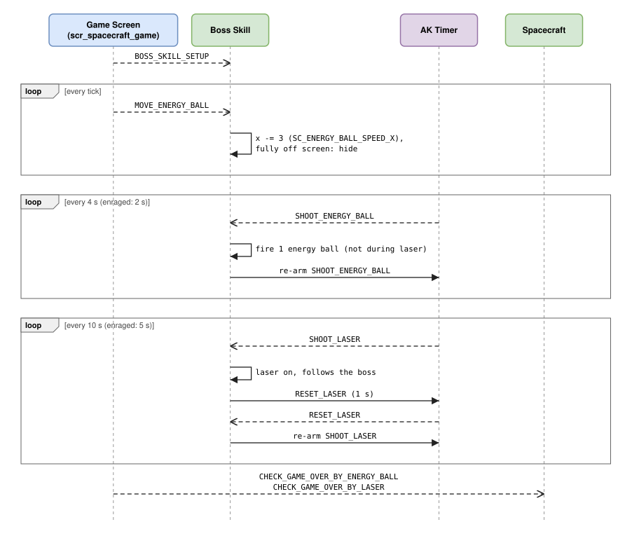
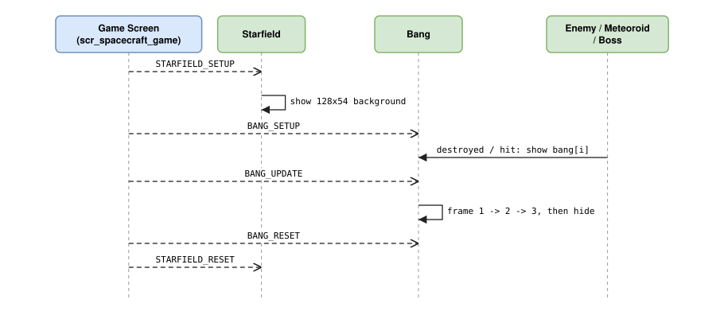

# Thiết kế sequence các object

[English](01-design-sequence-object.md) · **Tiếng Việt**

Mỗi object trong Space King là một **active object**: một task riêng, một hàm xử lý signal (`sc_game_<object>_handle`) và dữ liệu do chính task đó sở hữu. Object nhận signal từ:

- **Game Screen** (`scr_spacecraft_game`): signal SETUP / RESET và các signal cập nhật mỗi tick 100 ms,
- **nút bấm** (`app_bsp.cpp`): bắn, di chuyển tàu,
- **AK Timer**: các hành động định kỳ riêng của object (spawn, di chuyển, bắn),
- **object khác**: ví dụ Boss gửi `SC_GAME_GIFT_OF_BOSS` cho Gift.

Tất cả task game cùng `TASK_PRI_LEVEL_4`, nên message được xử lý tuần tự theo đúng thứ tự gửi (FIFO), mỗi handler chạy hết rồi mới tới handler sau (run-to-completion).

Quy ước trong sơ đồ: **nét liền** là gọi hàm trực tiếp, **nét đứt** là message được post vào hàng đợi hoặc do timer phát, mũi tên **vào AK Timer** là `timer_set()` với chu kỳ ghi trong ngoặc.

## I. Tổng quan object

| Object | Task ID | Handler | Nhiệm vụ chính |
|---|---|---|---|
| Spacecraft | `SC_GAME_SPACECRAFT_ID` | `sc_game_spacecraft_handle()` | Vị trí tàu, tim, sức mạnh mũi tên, va chạm, chết / hồi sinh |
| Arrow | `SC_GAME_ARROW_ID` | `sc_game_arrow_handle()` | Bắn và di chuyển mũi tên của người chơi |
| Enemy | `SC_GAME_ENEMY_ID` | `sc_game_enemy_handle()` | Đội hình, di chuyển, trúng đạn, hồi sinh, kiểm tra thắng (round 1-3) |
| Arrow Enemy | `SC_GAME_ARROW_ENEMY_ID` | `sc_game_arrow_enemy_handle()` | Đạn của enemy |
| Meteoroid | `SC_GAME_METEOROID_ID` | `sc_game_meteoroid_handle()` | Spawn, rơi, trúng đạn, đếm còn lại (round 4) |
| Gift | `SC_GAME_GIFT_ID` | `sc_game_gift_handle()` | Gắn quà cho object, thả, di chuyển, nhận quà |
| Boss | `SC_GAME_BOSS_ID` | `sc_game_boss_handle()` | Di chuyển, trúng đạn, nổi giận, kiểm tra thắng (round 5) |
| Boss Skill | `SC_GAME_BOSS_SKILL_ID` | `sc_game_boss_skill_handle()` | Energy ball và laser |
| Bang | `SC_GAME_BANG_ID` | `sc_game_bang_handle()` | Animation nổ |
| Starfield | `SC_GAME_STARFIELD_ID` | `sc_game_starfield_handle()` | Ảnh nền |

## II. Spacecraft

- **Setup:** đặt tàu tại `x = 0, y = 20`, hiện tàu, lấy `hearts` và `arrow_power` từ `save_data` (tiến trình được lưu giữa các round).
- **Input:** nút UP / DOWN (và FORWARD / BACKWARD khi giữ nút ở round 4) dịch thẳng `spacecraft.x/y`, bước 5 px, giới hạn `y` trong 0..40 và `x` trong 0..110.
- **Mỗi tick:** Game Screen gửi signal kiểm tra va chạm tương ứng với round (`CHECK_GAME_OVER_BY_ENEMY | METEOROID | ENERGY_BALL | LASER`).
- **Trúng đạn enemy / energy ball:** đạn bay sang trái; `pass_x` = mũi tàu (`x + 15`) − 2/3 chiều ngang tàu (`SPACECRAFT_SHOT_PASS_X` = 10 px). Dựa vào `y` của tàu ở lần kiểm tra trước để phân biệt hai trường hợp:
  - **Trực diện** (tàu đã nằm sẵn trên đường đạn): trúng khi đầu đạn vượt qua `pass_x` trong tick này, tức đạn đã vào tàu 10 px.
  - **Tàu di chuyển vào đường đạn:** trúng nếu đạn đang chồng lên tàu và **đuôi** đạn (`x + 10` với đạn enemy, `x + 8` với energy ball) chưa vượt qua `pass_x`; đuôi đạn đã qua mũi tàu từ 2/3 trở lên thì không bao giờ tính trúng nữa, đạn bay tiếp tới khi ra khỏi màn hình.
- **Trúng đạn:** `scGameSpacecraftHandleDeath()` không xoá tàu ngay mà bật `is_hit_showing` và hẹn `SPACECRAFT_HIT_DONE` (300 ms). Trong lúc đó tàu vẫn được vẽ tại chỗ bị trúng, chồng lên viên đạn, để người xem thấy rõ là trúng; tàu không di chuyển, không bắn được và các lần trúng khác bị bỏ qua.
- **Chết:** `scGameSpacecraftHitDone()` ẩn tàu, giảm 1 tim, chia đôi sức mạnh mũi tên. Hết tim thì gửi `SC_GAME_CHECK_GAME_OVER`. Còn tim thì hẹn `SPACECRAFT_SETUP` sau 1 s (hồi sinh) và `RESET_INVINCIBLE` sau 3 s (hết bất tử). Từ lúc hồi sinh đến `RESET_INVINCIBLE` (khoảng 2 s) tàu nhấp nháy: khi `is_invincible` bật, `sc_game_spacecraft_display()` bỏ vẽ tàu 2 trong mỗi 4 khung hình. `HandleDeath()` bỏ qua nếu tàu đã ẩn hoặc đang hiển thị trúng đạn, tránh một lần trúng bị tính chết hai lần.
- **Reset:** đưa tàu về vị trí đầu, ẩn, tắt bất tử và trạng thái hiển thị trúng đạn.

***Hình 1:** Sequence của Spacecraft.*

## III. Arrow

- **Setup:** ẩn 10 slot mũi tên.
- **Input:** nút MODE gửi `SC_GAME_ARROW_SHOOT` ngay lúc nhấn. Nếu còn mũi tên (`settingsetup.num_arrow > 0`), tàu đang hiện và không đang hiển thị trúng đạn thì bật một mũi tên tại vị trí tàu (`x = spacecraft.x`, `y = spacecraft.y + 5`), giảm `num_arrow` và phát tiếng. Hết mũi tên (`num_arrow == 0`) thì kêu 3 tiếng bíp.
- **Mỗi tick:** `SC_GAME_ARROW_RUN` dịch mũi tên sang phải `arrow_speed` px; khi mũi tên đã ra **hết** khỏi màn hình (`x >= 128`) thì ẩn và trả lại vào `num_arrow`. Enemy và thiên thạch còn ở ngoài màn hình (`x >= 128`) không bị bắn trúng.
- **Trúng mục tiêu:** việc kiểm tra va chạm do Enemy / Meteoroid / Boss thực hiện; khi trúng, object đó trừ máu theo `arrow_power`, ẩn mũi tên và trả lại `num_arrow`.
- **Reset:** ẩn mọi mũi tên.

***Hình 2:** Sequence của Arrow.*

## IV. Enemy - round 1

- **Setup:** `SC_GAME_ENEMY_SETUP_MOVE_X` đặt 10 enemy ở mép phải (`x = 141`), `hp = round * 2`, `hearts = level`, rồi bắt đầu chuỗi xếp đội hình.
- **Xếp đội hình:** 4 đội bay vào lần lượt `BUILD_TEAM_3 → 2 → 1 → 0`. `BUILD_TEAM_n` chỉ đánh dấu đội đó đang bay vào; mỗi tick `ENEMY_UPDATE` dịch các đội đang bay 6 px (dừng đúng `target_x`), nên chuyển động khớp với khung hình. Đội kế tiếp nhích bước đầu tiên ngay trong tick đội trước vào chỗ (round 1 xếp xong sau khoảng 29 tick, tức 2,9 s). Khi đội cuối xếp xong thì bắt đầu bắn ngẫu nhiên (`ARROW_ENEMY_RANDOM_SHOOT`, periodic 2 s).
- **Mỗi tick:** `ENEMY_UPDATE` (animation 3 frame, mỗi frame 2 tick), `ENEMY_DETONATOR` (va chạm với mũi tên), `ENEMY_CHECK_WIN`.
- **Bị phá:** giảm 1 `hearts`, bật hiệu ứng nổ, thả gift nếu có. Nếu còn `hearts`, enemy hồi máu, hiện lại ở `x = 141` và `SC_GAME_ENEMY_RESPAWN` hẹn `BUILD_TEAM` của đội đó sau 1 s để bay vào chỗ cũ.
- **Thắng:** khi mọi enemy hết cả `hp` lẫn `hearts`, gửi `SC_GAME_ROUND_COMPLETE`.

***Hình 3:** Sequence của Enemy ở round 1.*

## V. Enemy - round 2 / 3

- **Setup:** `SC_GAME_ENEMY_SETUP_MOVE_Y` xếp enemy thành 4 cột cố định, ẩn phía trên màn hình.
- **Spawn (mỗi 2 s):** chọn 2 cột (một chẵn, một lẻ), bật một enemy còn `hearts` ở mỗi cột tại vị trí `y` ngẫu nhiên ngoài màn hình.
- **Di chuyển (mỗi tick, `ENEMY_MOVE_Y` / `_ZIGZAG_Y`):** `y` tăng 2 px mỗi tick (`SC_ENEMY_MOVE_SPEED_Y`). Ở round 3 (`ZIGZAG`), các cột chẵn đi ngược lên. Ra khỏi màn hình thì ẩn, chờ lượt spawn sau.
- **Bị phá:** giảm `hearts`, ẩn và hồi máu; nếu còn `hearts` sẽ được spawn lại ở lượt sau.
- **Thắng:** giống round 1.

***Hình 4:** Sequence của Enemy ở round 2 / 3.*

## VI. Arrow Enemy

- **Setup:** ẩn mọi viên đạn (mỗi enemy tối đa 3 viên).
- **Bắn:** round 1 dùng `ARROW_ENEMY_RANDOM_SHOOT` (mỗi 2 s, bốc 3 enemy khác nhau trong số đang hiện; còn dưới 3 con thì tất cả cùng bắn, nên tốc độ bắn không giảm khi enemy chết dần). Round 2 / 3 dùng `ARROW_ENEMY_SHOOT` (mỗi 1.5 s, mọi enemy đang hiện trên màn hình).
- **Mỗi tick:** `ARROW_ENEMY_RUN` dịch đạn sang trái `arrow_speed` px, chỉ ẩn khi viên đạn đã ra **hết** khỏi màn hình (`x + 10 <= 0`). Va chạm với tàu do Spacecraft kiểm tra (`CHECK_GAME_OVER_BY_ENEMY`), xem mục Spacecraft.
- **Reset:** ẩn mọi viên đạn.

***Hình 5:** Sequence của Arrow Enemy.*

## VII. Meteoroid - round 4

- **Setup:** ẩn 10 thiên thạch, `remaining_meteoroids = level * 20`.
- **Spawn (mỗi 2 s):** `scGameMeteoroidSpawn()` bật một thiên thạch ngẫu nhiên (nếu đang ẩn) ở 1 trong 5 vị trí `x`, `y = -20`, hồi đủ `hp = round * 2`.
- **Mỗi tick:** `DETONATOR` (trúng đạn: trừ máu; hết máu thì nổ, thả gift, giảm `remaining`), `CHECK_WIN` (`remaining == 0` thì thắng), `MOVE` (rơi chéo 2 px; ra khỏi đáy màn hình cũng tính là đã qua, giảm `remaining`). `remaining` không bao giờ giảm xuống dưới 0.

***Hình 6:** Sequence của Meteoroid.*

## VIII. Gift

- **Setup:** reset bộ đếm, xóa cờ `has_gift` của enemy / thiên thạch, xóa 4 slot gift.
- **Gắn quà:** `GIFT_RANDOM_FOR_ENEMY` (mỗi 5 s) chọn một enemy còn `hearts`, `GIFT_RANDOM_FOR_METEOROID` (mỗi 1 s) chọn một thiên thạch, miễn là object đó chưa có quà và còn slot trống; loại quà ngẫu nhiên `HEART` hoặc `ARROW_POWER`. Dừng khi đã phát đủ 4 quà trong round.
- **Thả quà:** khi object mang quà bị phá, slot quà của chính object đó hiện ra tại vị trí object. Boss thả quà qua `SC_GAME_GIFT_OF_BOSS` mỗi khi mất 20 % máu.
- **Mỗi tick:** `GIFT_RUN` dịch quà sang trái 2 px; `GIFT_CHECK_RECEIVE` kiểm tra chạm tàu: `HEART` +1 tim, `ARROW_POWER` +1 sức mạnh mũi tên.

***Hình 7:** Sequence của Gift.*

## IX. Boss - round 5

- **Setup:** `x = 80, y = 30`, `hp = level * 50`, mốc quà đầu tiên ở 80 % máu.
- **Mỗi tick:** `BOSS_UPDATE` (animation), `BOSS_MOVE` (đi 2 px theo hướng hiện tại trong vùng `x` 48..108, `y` 0..34, laser đi theo; cứ 5 bước đổi hướng ngẫu nhiên), `BOSS_HIT` (trúng đạn: trừ máu, nổ; dưới 50 % máu thì **enraged**; qua mỗi mốc 20 % thì thả quà), `BOSS_CHECK_WIN` (`hp <= 0` thì thắng).

***Hình 8:** Sequence của Boss.*

## X. Boss Skill

- **Energy ball:** `SHOOT_ENERGY_BALL` (one-shot, 4 s, còn 2 s khi enraged, tự hẹn lại) bắn một quả cầu từ boss; không bắn khi laser đang bật. `MOVE_ENERGY_BALL` (mỗi tick) dịch quả cầu sang trái, 3 px mỗi tick (`SC_ENERGY_BALL_SPEED_X`).
- **Laser:** `SHOOT_LASER` (10 s, còn 5 s khi enraged) bật tia laser ngang màn hình theo boss, hẹn `RESET_LASER` sau 1 s; `RESET_LASER` tắt laser và hẹn lượt bắn tiếp theo. Hai signal này luân phiên nên dùng timer one-shot.
- **Va chạm:** do Spacecraft kiểm tra (`CHECK_GAME_OVER_BY_ENERGY_BALL`, `_BY_LASER`); energy ball dùng cùng quy tắc 2/3 như đạn enemy và chỉ ẩn khi ra hết khỏi màn hình.

***Hình 9:** Sequence của Boss Skill.*

## XI. Bang và Starfield

- **Bang:** Enemy / Meteoroid / Boss bật `bang[i]` tại vị trí bị phá; mỗi tick `BANG_UPDATE` chuyển frame 1 → 2 → 3 rồi ẩn.
- **Starfield:** ảnh nền tĩnh 128x54, chỉ có SETUP (hiện) và RESET (ẩn).

***Hình 10:** Sequence của Bang và Starfield.*

## XII. Thứ tự signal trong một tick

Mỗi `SC_GAME_TIME_TICK` (100 ms), `scGameSpacecraftTimeTick()` gửi theo thứ tự:

1. `SC_GAME_ARROW_RUN`
2. `SC_GAME_BANG_UPDATE`
3. `SC_GAME_GIFT_CHECK_RECEIVE`
4. `SC_GAME_GIFT_RUN`
5. Theo round:
   - **Round 1-3:** (round 2: `ENEMY_MOVE_Y`, round 3: `ENEMY_MOVE_ZIGZAG_Y`), `ARROW_ENEMY_RUN`, `ENEMY_UPDATE`, `ENEMY_DETONATOR`, `ENEMY_CHECK_WIN`, `SPACECRAFT_CHECK_GAME_OVER_BY_ENEMY`
   - **Round 4:** `METEOROID_DETONATOR`, `METEOROID_CHECK_WIN`, `METEOROID_MOVE`, `SPACECRAFT_CHECK_GAME_OVER_BY_METEOROID`
   - **Round 5:** `BOSS_SKILL_MOVE_ENERGY_BALL`, `BOSS_UPDATE`, `BOSS_MOVE`, `BOSS_HIT`, `BOSS_CHECK_WIN`, `SPACECRAFT_CHECK_GAME_OVER_BY_ENERGY_BALL`, `SPACECRAFT_CHECK_GAME_OVER_BY_LASER`
6. `SC_GAME_RENDER` → Display: nằm sau toàn bộ message cập nhật ở trên, nên khung hình thể hiện vị trí của chính tick này.

## XIII. Tham chiếu mã nguồn

Đường dẫn tính từ `ak-base-kit-stm32l151/application/sources/app/`.

| Object | Source | Header |
|---|---|---|
| Spacecraft | `game/spacecraft_game/sc_game_spacecraft.cpp` | `sc_game_spacecraft.h` |
| Arrow | `game/spacecraft_game/sc_game_arrow.cpp` | `sc_game_arrow.h` |
| Enemy | `game/spacecraft_game/sc_game_enemy.cpp` | `sc_game_enemy.h` |
| Arrow Enemy | `game/spacecraft_game/sc_game_arrow_enemy.cpp` | `sc_game_arrow_enemy.h` |
| Meteoroid | `game/spacecraft_game/sc_game_meteoroid.cpp` | `sc_game_meteoroid.h` |
| Gift | `game/spacecraft_game/sc_game_gift.cpp` | `sc_game_gift.h` |
| Boss | `game/spacecraft_game/sc_game_boss.cpp` | `sc_game_boss.h` |
| Boss Skill | `game/spacecraft_game/sc_game_boss_skill.cpp` | `sc_game_boss_skill.h` |
| Bang | `game/spacecraft_game/sc_game_bang.cpp` | `sc_game_bang.h` |
| Starfield | `game/spacecraft_game/sc_game_starfield.cpp` | `sc_game_starfield.h` |
| Signal, interval | `app.h` | |
