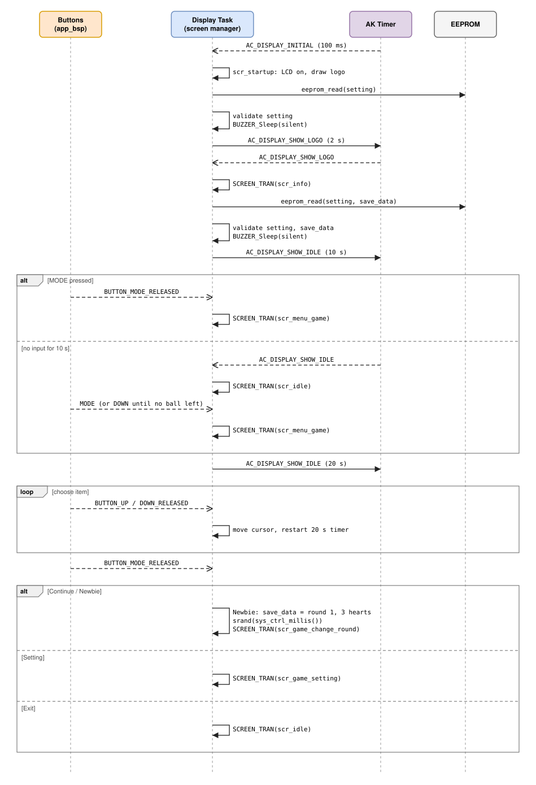
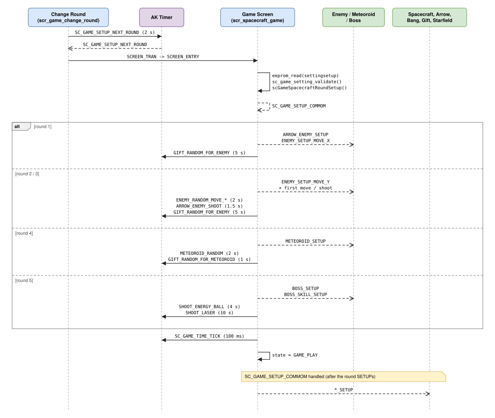
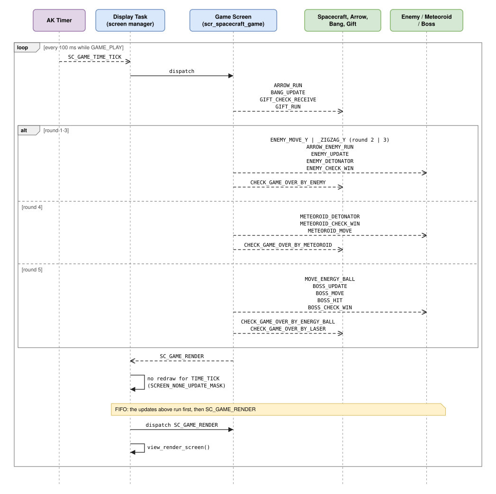
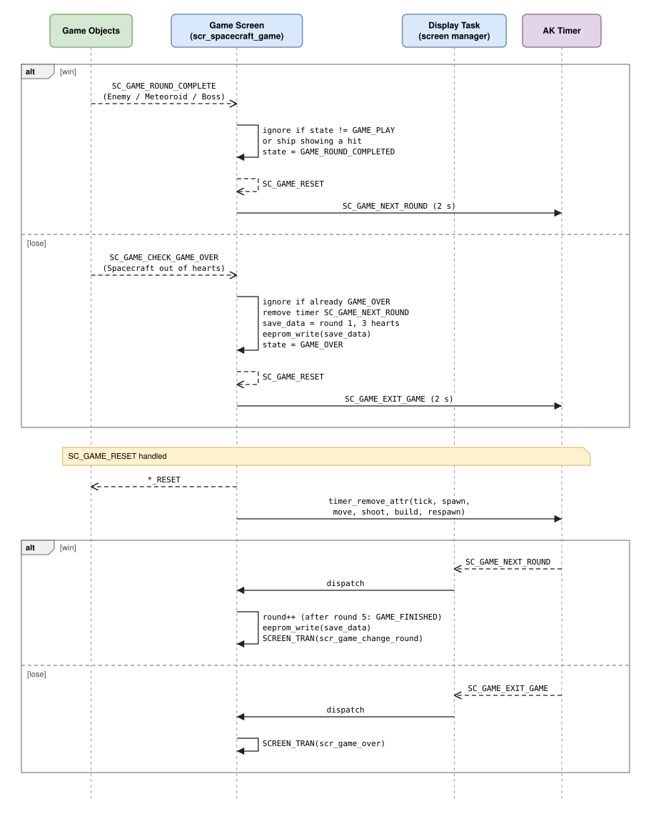
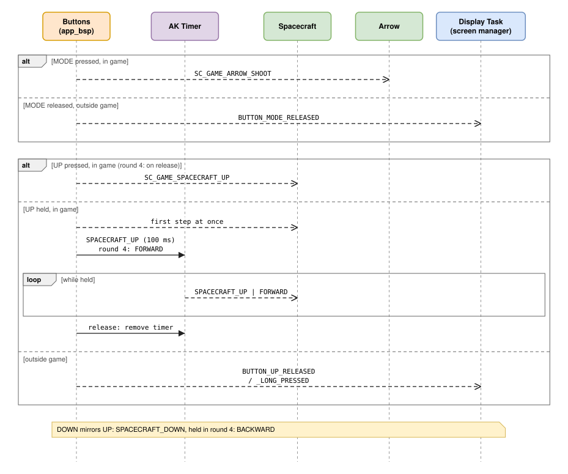

# Runtime Signal Processing

**English** · [Tiếng Việt](02-thiet-ke-sequence-runtime.md)

How Space King runs: from power-on, through the menu, into a round, the 100 ms tick loop, until the round is won or lost; and how button events are handled.

## I. Overview

The firmware runs on the **AK Active Kernel**, an event-driven kernel:

- Each component is a **task** with a message queue per priority. A task runs only when it has a message and runs its handler to completion (no preemption between tasks of the same priority).
- Tasks talk through **signals** (`task_post_pure_msg`, `task_post_common_msg`) and **software timers** (`timer_set(task, signal, ms, TIMER_ONE_SHOT | TIMER_PERIODIC)`).
- The **Display Task** (`AC_TASK_DISPLAY_ID`) hosts the **screen manager**: it forwards messages to the current screen and redraws the screen after each message it handles (`view_render_screen()`), unless the screen calls `SCREEN_NONE_UPDATE_MASK()` (the game screen does so for `SC_GAME_TIME_TICK`, see VI).

Main runtime flow:

1. Boot: read settings and apply Silent → logo → Info reads settings + save data → idle / menu.
2. **Continue** / **Newbie** → round transition screen → game screen.
3. The game screen sends SETUP to the objects and starts the 100 ms tick plus the round's own timers.
4. Each tick, the Game Screen sends update signals to every object; the Display Task redraws the frame.
5. An object detects win / loss → objects and timers are reset → round transition or game over screen.

Diagram legend: **solid arrow** is a direct call, **dashed arrow** is a queued message or timer event, an arrow **into AK Timer** is `timer_set()`.

### 1. Boot and menu

The startup screen reads the settings from EEPROM and applies Silent (`BUZZER_Sleep`) before anything plays a sound; the Info screen reads them again and re-applies Silent. Pressing MODE on the startup screen skips the logo. On the idle screen, UP adds a ball, DOWN removes one (back to the menu when none is left), MODE returns to the menu immediately.

***Figure 1:** Boot, info, idle and menu screens.*

### 2. Round start

The `SC_GAME_SETUP_NEXT_ROUND` timer is delivered to the `SC_GAME_CHANGE_ROUND_ID` task, which switches to the game screen. `scGameSpacecraftRoundSetup(round)` posts `SC_GAME_SETUP_COMMOM`, sends SETUP to the round's objects and starts the round's timers (fixed periods use `TIMER_PERIODIC`). The common objects receive their SETUP when `SC_GAME_SETUP_COMMOM` is handled, i.e. after the round's SETUPs.

***Figure 2:** Starting a round.*

### 3. Game tick (100 ms)

***Figure 3:** Game screen tick loop.*

### 4. Round end

Enemy / Meteoroid / Boss send `SC_GAME_ROUND_COMPLETE`; the Spacecraft sends `SC_GAME_CHECK_GAME_OVER` when out of hearts. Both handlers check `sc_game_state` so only one branch runs; if a win and a loss happen together, **the loss wins**: `SC_GAME_ROUND_COMPLETE` is also ignored while the ship is showing a hit (`is_hit_showing`), and the win checks repeat every tick, so the round only completes after `HIT_DONE` if the ship still has hearts. Both branches post `SC_GAME_RESET` (reset objects, remove timers) and switch screens 2 s later.

***Figure 4:** Round cleared or game over.*

### 5. Button handling

***Figure 5:** From button callbacks to the receiving task.*

## II. Code References

Paths are relative to `ak-base-kit-stm32l151/application/sources/`.

| Area | File |
|---|---|
| Task IDs, task table | `app/task_list.h`, `app/task_list.cpp` |
| Signals, timer intervals | `app/app.h` |
| Button callbacks | `app/app_bsp.cpp` |
| Init, start-up timer | `app/app.cpp` |
| Screen manager | `common/screen_manager.cpp`, `app/task_display.cpp` |
| Game screen, round setup, tick, reset | `app/screens/scr_spacecraft_game.cpp` |
| Round transition, game over, menu | `app/screens/scr_game_change_round.cpp`, `scr_game_over.cpp`, `scr_menu_game.cpp` |
| Kernel: task, timer, message | `ak/src/task.c`, `ak/src/timer.c`, `ak/src/message.c` |
| EEPROM layout, settings | `app/app_eeprom.h` |

## III. Task Ownership

| Task | Responsibility | Owned data | Main signals received |
|---|---|---|---|
| `AC_TASK_DISPLAY_ID` | Screen manager, rendering | Current screen | `AC_DISPLAY_*`, `SC_GAME_TIME_TICK`, `SC_GAME_RENDER`, `SC_GAME_NEXT_ROUND`, `SC_GAME_EXIT_GAME` |
| `SC_GAME_SCREEN_ID` | Round control | `sc_game_state`, `save_data`, `settingsetup` | `SC_GAME_SETUP_COMMOM`, `SC_GAME_ROUND_COMPLETE`, `SC_GAME_CHECK_GAME_OVER`, `SC_GAME_RESET` |
| `SC_GAME_CHANGE_ROUND_ID` | Timed switch into the game screen | | `SC_GAME_SETUP_NEXT_ROUND` |
| `SC_GAME_SPACECRAFT_ID` | Player spacecraft | `spacecraft` | `SPACECRAFT_*` |
| `SC_GAME_ARROW_ID` | Player arrows | `arrow[10]` | `ARROW_*` |
| `SC_GAME_ENEMY_ID` | Enemies | `enemy[10]` | `ENEMY_*` |
| `SC_GAME_ARROW_ENEMY_ID` | Enemy shots | `enemy[i].arrow[3]` | `ARROW_ENEMY_*` |
| `SC_GAME_METEOROID_ID` | Meteoroids | `meteoroid[10]`, `remaining_meteoroids` | `METEOROID_*` |
| `SC_GAME_GIFT_ID` | Gifts | `gift[4]` | `GIFT_*` |
| `SC_GAME_BOSS_ID` | Boss | `boss`, `boss_enraged` | `BOSS_*` |
| `SC_GAME_BOSS_SKILL_ID` | Boss skills | `energy_ball[3]`, `laser` | `BOSS_SKILL_*` |
| `SC_GAME_BANG_ID` | Explosions | `bang[10]` | `BANG_*` |
| `SC_GAME_STARFIELD_ID` | Background | `starfield` | `STARFIELD_*` |

Note: `SC_GAME_SCREEN_ID` and the game screen on the Display Task share the handler `scr_spacecraft_game_handle()`. Signals sent through `AC_TASK_DISPLAY_ID` are followed by a redraw (except `SC_GAME_TIME_TICK`, which leaves the redraw to `SC_GAME_RENDER`); signals sent straight to `SC_GAME_SCREEN_ID` are not.

## IV. Timers

| Signal | Receiver | Period | Type |
|---|---|---|---|
| `SC_GAME_SETUP_NEXT_ROUND` | Change Round | 2000 ms | ONE_SHOT |
| `SC_GAME_TIME_TICK` | Display | 100 ms | PERIODIC |
| `SC_GAME_ENEMY_RANDOM_MOVE_Y` / `_ZIGZAG_Y` | Enemy | 2000 ms | PERIODIC |
| `SC_GAME_ENEMY_BUILD_TEAM_0..3` | Enemy | 1000 ms (respawn only) | ONE_SHOT; the fly-in itself runs on the tick |
| `SC_GAME_ARROW_ENEMY_RANDOM_SHOOT` | Arrow Enemy | 2000 ms | PERIODIC |
| `SC_GAME_ARROW_ENEMY_SHOOT` | Arrow Enemy | 1500 ms | PERIODIC |
| `SC_GAME_METEOROID_RANDOM` | Meteoroid | 2000 ms | PERIODIC |
| `SC_GAME_GIFT_RANDOM_FOR_ENEMY` | Gift | 5000 ms | ONE_SHOT, re-armed while < 4 gifts |
| `SC_GAME_GIFT_RANDOM_FOR_METEOROID` | Gift | 1000 ms | ONE_SHOT, re-armed while < 4 gifts |
| `SC_GAME_BOSS_SKILL_SHOOT_ENERGY_BALL` | Boss Skill | 4000 ms (enraged: 2000) | ONE_SHOT, re-armed |
| `SC_GAME_BOSS_SKILL_SHOOT_LASER` ↔ `RESET_LASER` | Boss Skill | 10000 ms (enraged: 5000) ↔ 1000 ms | ONE_SHOT, alternating |
| `SC_GAME_SPACECRAFT_HIT_DONE` | Spacecraft | 300 ms | ONE_SHOT, after a hit |
| `SC_GAME_SPACECRAFT_SETUP` / `RESET_INVINCIBLE` | Spacecraft | 1000 / 3000 ms | ONE_SHOT, after `HIT_DONE` |
| `SC_GAME_SPACECRAFT_UP/DOWN/FORWARD/BACKWARD` | Spacecraft | 100 ms (`SC_GAME_SPACECRAFT_MOVE_INTERVAL`) | PERIODIC, while a button is held |
| `SC_GAME_NEXT_ROUND` / `SC_GAME_EXIT_GAME` | Display | 2000 ms | ONE_SHOT |

Timers whose period depends on state (energy ball, laser) must be ONE_SHOT: calling `timer_set()` on an existing timer only resets its counter, not its period.

## V. Button Rules

| Button | Event | In game (`GAME_PLAY`) | Outside the game |
|---|---|---|---|
| MODE | press (in game) / release (outside) | `SC_GAME_ARROW_SHOOT` → Arrow | `AC_DISPLAY_BUTTON_MODE_RELEASED` → Display |
| MODE | long press | `AC_DISPLAY_BUTTON_MODE_LONG_PRESSED` → Display (ignored by the game screen) | `AC_DISPLAY_BUTTON_MODE_LONG_PRESSED` → Display |
| UP | short press | `SC_GAME_SPACECRAFT_UP` → Spacecraft, sent on press (round 4: on release) | `AC_DISPLAY_BUTTON_UP_RELEASED` → Display |
| UP | long press | one step at once, then periodic 100 ms `SPACECRAFT_UP` (round 4: `FORWARD`), removed on release | `AC_DISPLAY_BUTTON_UP_LONG_PRESSED` → Display |
| DOWN | short press | `SC_GAME_SPACECRAFT_DOWN` → Spacecraft, sent on press (round 4: on release) | `AC_DISPLAY_BUTTON_DOWN_RELEASED` → Display |
| DOWN | long press | one step at once, then periodic 100 ms `SPACECRAFT_DOWN` (round 4: `BACKWARD`), removed on release | `AC_DISPLAY_BUTTON_DOWN_LONG_PRESSED` → Display |

## VI. Scheduling Notes

- All game tasks and the Display Task run at `TASK_PRI_LEVEL_4` and share one FIFO queue. Messages are handled in the order they were sent; a message posted by a handler goes behind everything already queued.
- On each tick the Display Task handles `SC_GAME_TIME_TICK`, which only posts update messages and skips the redraw (`SCREEN_NONE_UPDATE_MASK()`). The last message it posts is `SC_GAME_RENDER` to the Display Task; it is handled after every update, and the redraw that follows shows this tick's positions. Moving objects are all driven by the tick (no separate move timers), so they advance exactly once per frame.
- `timer_remove_attr()` removes the timer **and** deletes pending messages with that signal from the target task's queue, so `SC_GAME_RESET` stops a timer even if it has just fired.
- Object data are shared globals. Collision handlers write directly into other objects (e.g. `ENEMY_DETONATOR` hides `arrow[j]`, shows `bang[i]` and `gift[k]`). This is safe because all handlers run one after another from the same queue, never in parallel.
- `rand()` is seeded with `sys_ctrl_millis()` when the player starts a game from the menu, so every run plays out differently.
