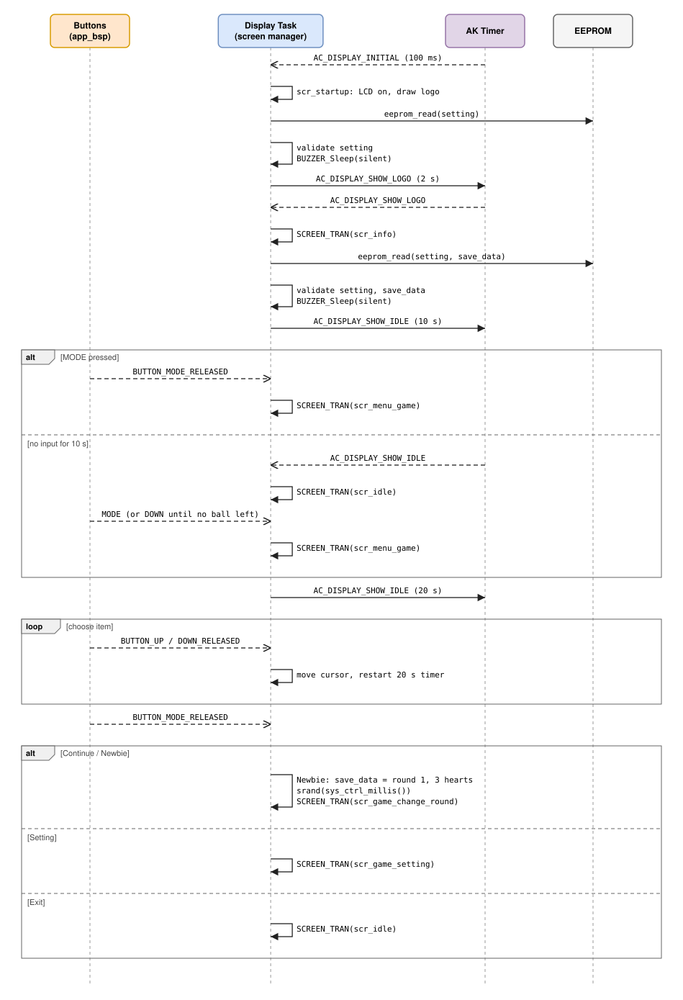
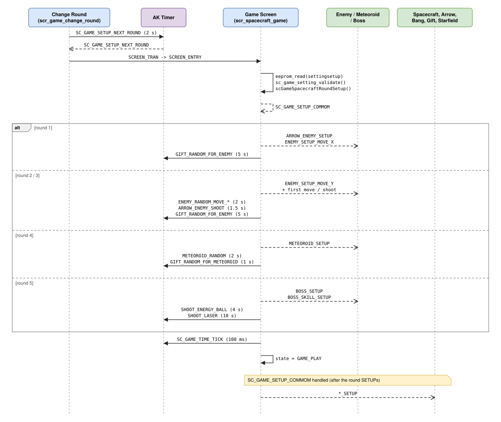
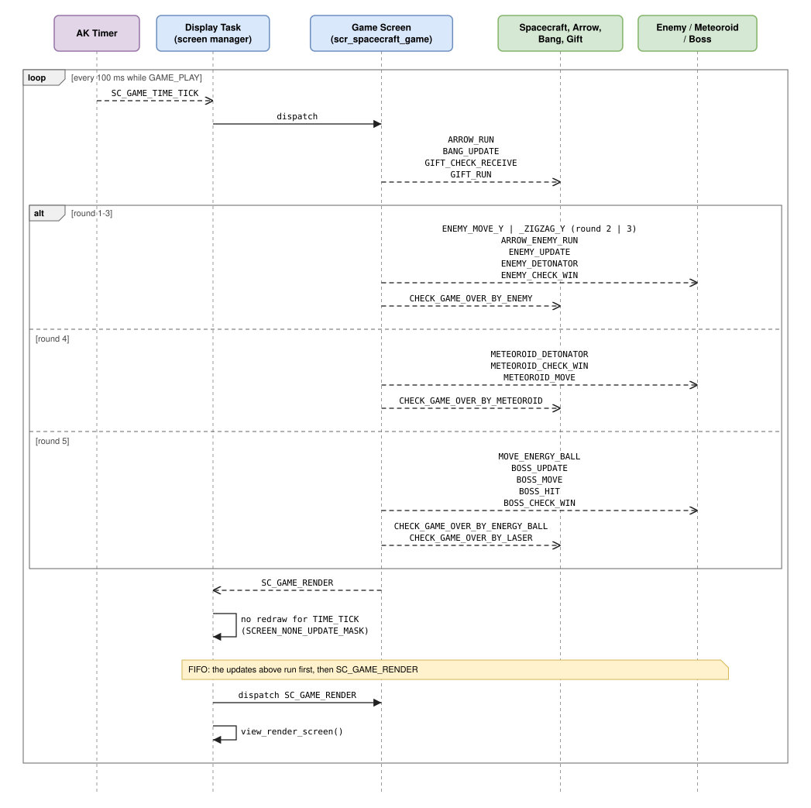
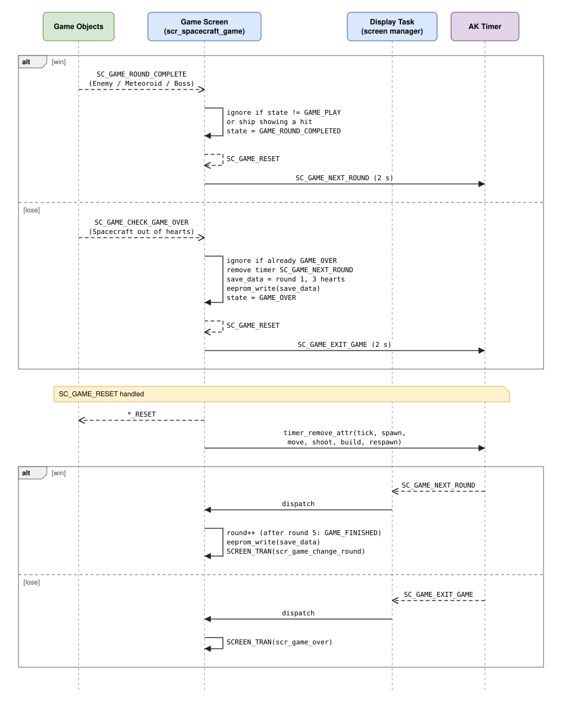
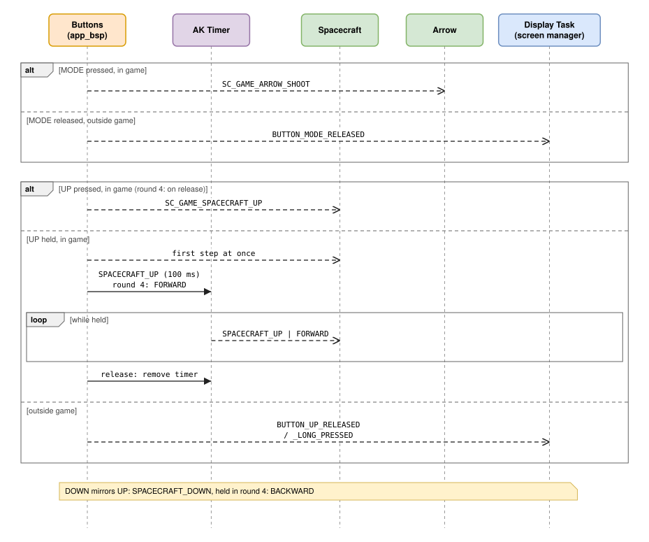

# Thiết kế sequence runtime

[English](02-design-sequence-runtime.md) · **Tiếng Việt**

Tài liệu này mô tả cách Space King chạy trong thời gian thực: từ lúc bật máy, qua menu, vào round, vòng lặp tick 100 ms, cho tới khi thắng hoặc thua; và cách xử lý nút bấm.

## I. Tổng quan

Firmware chạy trên **AK Active Kernel**, một kernel hướng sự kiện:

- Mỗi thành phần là một **task** có hàng đợi message riêng theo priority. Task chỉ chạy khi có message và chạy hết handler mới nhường (run-to-completion, không preempt giữa các task cùng priority).
- Các task giao tiếp bằng **signal** (`task_post_pure_msg`, `task_post_common_msg`) và **timer phần mềm** (`timer_set(task, signal, ms, TIMER_ONE_SHOT | TIMER_PERIODIC)`).
- **Display Task** (`AC_TASK_DISPLAY_ID`) chứa **screen manager**: chuyển tiếp message cho màn hình hiện tại, và vẽ lại màn hình sau mỗi message nó xử lý (`view_render_screen()`), trừ khi màn hình gọi `SCREEN_NONE_UPDATE_MASK()` (màn chơi làm vậy với `SC_GAME_TIME_TICK`, xem mục VI).

Luồng runtime chính:

1. Khởi động: đọc setting và áp dụng Silent → logo → màn Info đọc setting + save data → màn chờ / menu.
2. Chọn **Continue** / **Newbie** → màn chuyển round → màn chơi.
3. Màn chơi gửi SETUP cho các object và bật timer tick 100 ms cùng các timer riêng của round.
4. Mỗi tick, Game Screen gửi signal cập nhật cho từng object; Display Task vẽ lại khung hình.
5. Object phát hiện thắng / thua → reset object và timer → màn chuyển round hoặc game over.

Quy ước trong sơ đồ: **nét liền** là gọi hàm trực tiếp, **nét đứt** là message trong hàng đợi hoặc do timer phát, mũi tên **vào AK Timer** là `timer_set()`.

### 1. Khởi động và menu

Màn startup đọc setting từ EEPROM và áp dụng Silent (`BUZZER_Sleep`) trước khi có âm thanh nào phát ra; màn Info đọc lại và áp dụng Silent thêm lần nữa. Bấm MODE ở màn startup sẽ bỏ qua logo. Ở màn idle, UP thêm bóng, DOWN bớt bóng (hết bóng thì về menu), MODE về menu ngay.

***Hình 1:** Khởi động, màn thông tin, màn chờ và menu.*

### 2. Bắt đầu round

Timer `SC_GAME_SETUP_NEXT_ROUND` gửi tới task `SC_GAME_CHANGE_ROUND_ID`, task này chuyển sang màn chơi. `scGameSpacecraftRoundSetup(round)` post `SC_GAME_SETUP_COMMOM`, gửi SETUP cho object của round và bật timer của round (chu kỳ cố định thì dùng `TIMER_PERIODIC`). SETUP của các object chung được gửi khi xử lý `SC_GAME_SETUP_COMMOM`, tức là sau SETUP của round.

***Hình 2:** Bắt đầu một round.*

### 3. Game tick 100 ms

***Hình 3:** Vòng lặp tick của màn chơi.*

### 4. Kết thúc round

Enemy / Meteoroid / Boss gửi `SC_GAME_ROUND_COMPLETE`; Spacecraft hết tim gửi `SC_GAME_CHECK_GAME_OVER`. Hai handler kiểm tra `sc_game_state` để chỉ một nhánh chạy; thắng và thua cùng lúc thì **thua được ưu tiên**: `SC_GAME_ROUND_COMPLETE` cũng bị bỏ qua khi tàu đang hiển thị trúng đạn (`is_hit_showing`), mà kiểm tra thắng lặp lại mỗi tick, nên chỉ qua round sau `HIT_DONE` nếu tàu còn tim. Cả hai nhánh post `SC_GAME_RESET` (reset object, gỡ timer) rồi 2 s sau mới chuyển màn.

***Hình 4:** Thắng round hoặc game over.*

### 5. Xử lý nút bấm

***Hình 5:** Từ callback nút bấm tới task nhận.*

## II. Tham chiếu mã nguồn

Đường dẫn tính từ `ak-base-kit-stm32l151/application/sources/`.

| Phần | File |
|---|---|
| Task ID, bảng task | `app/task_list.h`, `app/task_list.cpp` |
| Signal, interval timer | `app/app.h` |
| Callback nút bấm | `app/app_bsp.cpp` |
| Khởi tạo, timer khởi động | `app/app.cpp` |
| Screen manager | `common/screen_manager.cpp`, `app/task_display.cpp` |
| Màn chơi, round setup, tick, reset | `app/screens/scr_spacecraft_game.cpp` |
| Màn chuyển round, game over, menu | `app/screens/scr_game_change_round.cpp`, `scr_game_over.cpp`, `scr_menu_game.cpp` |
| Kernel: task, timer, message | `ak/src/task.c`, `ak/src/timer.c`, `ak/src/message.c` |
| EEPROM layout, setting | `app/app_eeprom.h` |

## III. Task và dữ liệu sở hữu

| Task | Nhiệm vụ | Dữ liệu sở hữu | Signal nhận chính |
|---|---|---|---|
| `AC_TASK_DISPLAY_ID` | Screen manager, vẽ màn hình | Màn hình hiện tại | `AC_DISPLAY_*`, `SC_GAME_TIME_TICK`, `SC_GAME_RENDER`, `SC_GAME_NEXT_ROUND`, `SC_GAME_EXIT_GAME` |
| `SC_GAME_SCREEN_ID` | Điều phối round | `sc_game_state`, `save_data`, `settingsetup` | `SC_GAME_SETUP_COMMOM`, `SC_GAME_ROUND_COMPLETE`, `SC_GAME_CHECK_GAME_OVER`, `SC_GAME_RESET` |
| `SC_GAME_CHANGE_ROUND_ID` | Hẹn giờ chuyển vào màn chơi | | `SC_GAME_SETUP_NEXT_ROUND` |
| `SC_GAME_SPACECRAFT_ID` | Tàu người chơi | `spacecraft` | `SPACECRAFT_*` |
| `SC_GAME_ARROW_ID` | Mũi tên người chơi | `arrow[10]` | `ARROW_*` |
| `SC_GAME_ENEMY_ID` | Enemy | `enemy[10]` | `ENEMY_*` |
| `SC_GAME_ARROW_ENEMY_ID` | Đạn enemy | `enemy[i].arrow[3]` | `ARROW_ENEMY_*` |
| `SC_GAME_METEOROID_ID` | Thiên thạch | `meteoroid[10]`, `remaining_meteoroids` | `METEOROID_*` |
| `SC_GAME_GIFT_ID` | Quà | `gift[4]` | `GIFT_*` |
| `SC_GAME_BOSS_ID` | Boss | `boss`, `boss_enraged` | `BOSS_*` |
| `SC_GAME_BOSS_SKILL_ID` | Kỹ năng boss | `energy_ball[3]`, `laser` | `BOSS_SKILL_*` |
| `SC_GAME_BANG_ID` | Hiệu ứng nổ | `bang[10]` | `BANG_*` |
| `SC_GAME_STARFIELD_ID` | Ảnh nền | `starfield` | `STARFIELD_*` |

Lưu ý: `SC_GAME_SCREEN_ID` và màn chơi trên Display Task dùng chung handler `scr_spacecraft_game_handle()`. Signal gửi qua `AC_TASK_DISPLAY_ID` thì màn hình được vẽ lại sau đó (trừ `SC_GAME_TIME_TICK`, để `SC_GAME_RENDER` vẽ); signal gửi thẳng `SC_GAME_SCREEN_ID` thì không.

## IV. Timer

| Signal | Task nhận | Chu kỳ | Loại |
|---|---|---|---|
| `SC_GAME_SETUP_NEXT_ROUND` | Change Round | 2000 ms | ONE_SHOT |
| `SC_GAME_TIME_TICK` | Display | 100 ms | PERIODIC |
| `SC_GAME_ENEMY_RANDOM_MOVE_Y` / `_ZIGZAG_Y` | Enemy | 2000 ms | PERIODIC |
| `SC_GAME_ENEMY_BUILD_TEAM_0..3` | Enemy | 1000 ms (chỉ khi hồi sinh) | ONE_SHOT; việc bay vào chạy theo tick |
| `SC_GAME_ARROW_ENEMY_RANDOM_SHOOT` | Arrow Enemy | 2000 ms | PERIODIC |
| `SC_GAME_ARROW_ENEMY_SHOOT` | Arrow Enemy | 1500 ms | PERIODIC |
| `SC_GAME_METEOROID_RANDOM` | Meteoroid | 2000 ms | PERIODIC |
| `SC_GAME_GIFT_RANDOM_FOR_ENEMY` | Gift | 5000 ms | ONE_SHOT, tự hẹn lại khi còn < 4 quà |
| `SC_GAME_GIFT_RANDOM_FOR_METEOROID` | Gift | 1000 ms | ONE_SHOT, tự hẹn lại khi còn < 4 quà |
| `SC_GAME_BOSS_SKILL_SHOOT_ENERGY_BALL` | Boss Skill | 4000 ms (enraged: 2000) | ONE_SHOT, tự hẹn lại |
| `SC_GAME_BOSS_SKILL_SHOOT_LASER` ↔ `RESET_LASER` | Boss Skill | 10000 ms (enraged: 5000) ↔ 1000 ms | ONE_SHOT, luân phiên |
| `SC_GAME_SPACECRAFT_HIT_DONE` | Spacecraft | 300 ms | ONE_SHOT, sau khi trúng đạn |
| `SC_GAME_SPACECRAFT_SETUP` / `RESET_INVINCIBLE` | Spacecraft | 1000 / 3000 ms | ONE_SHOT, sau `HIT_DONE` |
| `SC_GAME_SPACECRAFT_UP/DOWN/FORWARD/BACKWARD` | Spacecraft | 100 ms (`SC_GAME_SPACECRAFT_MOVE_INTERVAL`) | PERIODIC, khi giữ nút |
| `SC_GAME_NEXT_ROUND` / `SC_GAME_EXIT_GAME` | Display | 2000 ms | ONE_SHOT |

Timer có chu kỳ thay đổi theo trạng thái (energy ball, laser) phải dùng ONE_SHOT, vì `timer_set()` trên một timer đã tồn tại chỉ đặt lại bộ đếm, không đổi chu kỳ.

## V. Quy tắc nút bấm

| Nút | Sự kiện | Trong game (`GAME_PLAY`) | Ngoài game |
|---|---|---|---|
| MODE | nhấn (trong game) / nhả (ngoài game) | `SC_GAME_ARROW_SHOOT` → Arrow | `AC_DISPLAY_BUTTON_MODE_RELEASED` → Display |
| MODE | giữ lâu | `AC_DISPLAY_BUTTON_MODE_LONG_PRESSED` → Display (màn chơi bỏ qua) | `AC_DISPLAY_BUTTON_MODE_LONG_PRESSED` → Display |
| UP | nhấn ngắn | `SC_GAME_SPACECRAFT_UP` → Spacecraft, gửi lúc nhấn (round 4: lúc nhả) | `AC_DISPLAY_BUTTON_UP_RELEASED` → Display |
| UP | giữ lâu | đi 1 bước ngay, rồi timer periodic 100 ms `SPACECRAFT_UP` (round 4: `FORWARD`), gỡ khi nhả | `AC_DISPLAY_BUTTON_UP_LONG_PRESSED` → Display |
| DOWN | nhấn ngắn | `SC_GAME_SPACECRAFT_DOWN` → Spacecraft, gửi lúc nhấn (round 4: lúc nhả) | `AC_DISPLAY_BUTTON_DOWN_RELEASED` → Display |
| DOWN | giữ lâu | đi 1 bước ngay, rồi timer periodic 100 ms `SPACECRAFT_DOWN` (round 4: `BACKWARD`), gỡ khi nhả | `AC_DISPLAY_BUTTON_DOWN_LONG_PRESSED` → Display |

## VI. Ghi chú lập lịch

- Tất cả task game và Display Task cùng `TASK_PRI_LEVEL_4`, nên dùng chung một hàng đợi FIFO. Message được xử lý đúng thứ tự gửi; message do một handler gửi thêm sẽ nằm sau toàn bộ message đã có trong hàng đợi.
- Mỗi tick, Display Task xử lý `SC_GAME_TIME_TICK`: chỉ post message cập nhật và bỏ qua lần vẽ (`SCREEN_NONE_UPDATE_MASK()`). Message cuối cùng nó post là `SC_GAME_RENDER` gửi Display Task; message này được xử lý sau mọi cập nhật, nên lần vẽ ngay sau đó thể hiện vị trí của chính tick này. Mọi object di chuyển đều chạy theo tick (không còn timer di chuyển riêng), nên mỗi khung hình chúng đi đúng một bước.
- `timer_remove_attr()` gỡ timer **và** xóa message cùng signal đang chờ trong hàng đợi của task đích, nên `SC_GAME_RESET` dừng được timer kể cả khi timer vừa phát.
- Dữ liệu object là biến toàn cục dùng chung. Handler va chạm ghi trực tiếp vào object khác (ví dụ `ENEMY_DETONATOR` ẩn `arrow[j]`, bật `bang[i]`, hiện `gift[k]`). Việc này an toàn vì mọi handler chạy tuần tự trên cùng một hàng đợi, không có hai handler chạy song song.
- `rand()` được seed bằng `sys_ctrl_millis()` khi người chơi chọn vào game ở menu, nên mỗi ván có diễn biến khác nhau.
